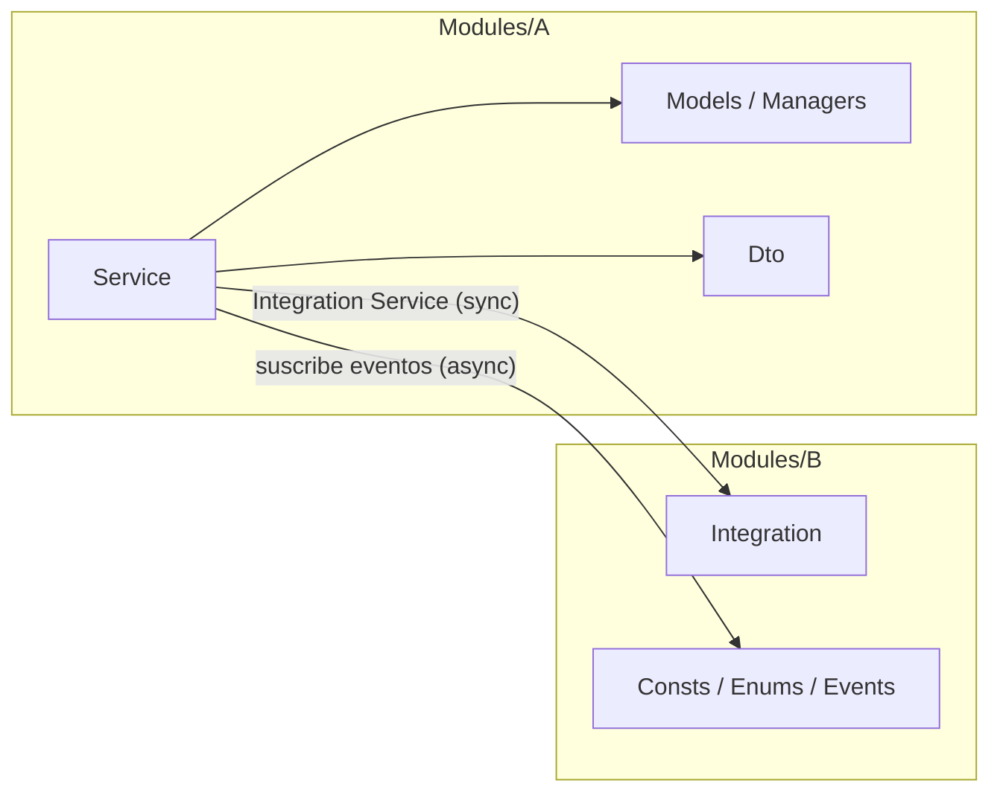
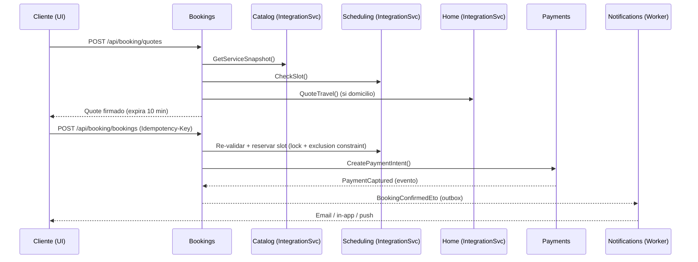
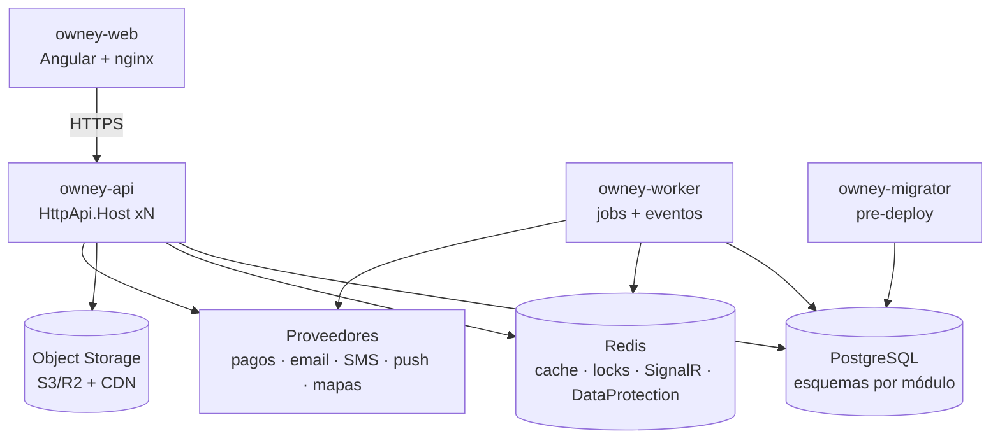
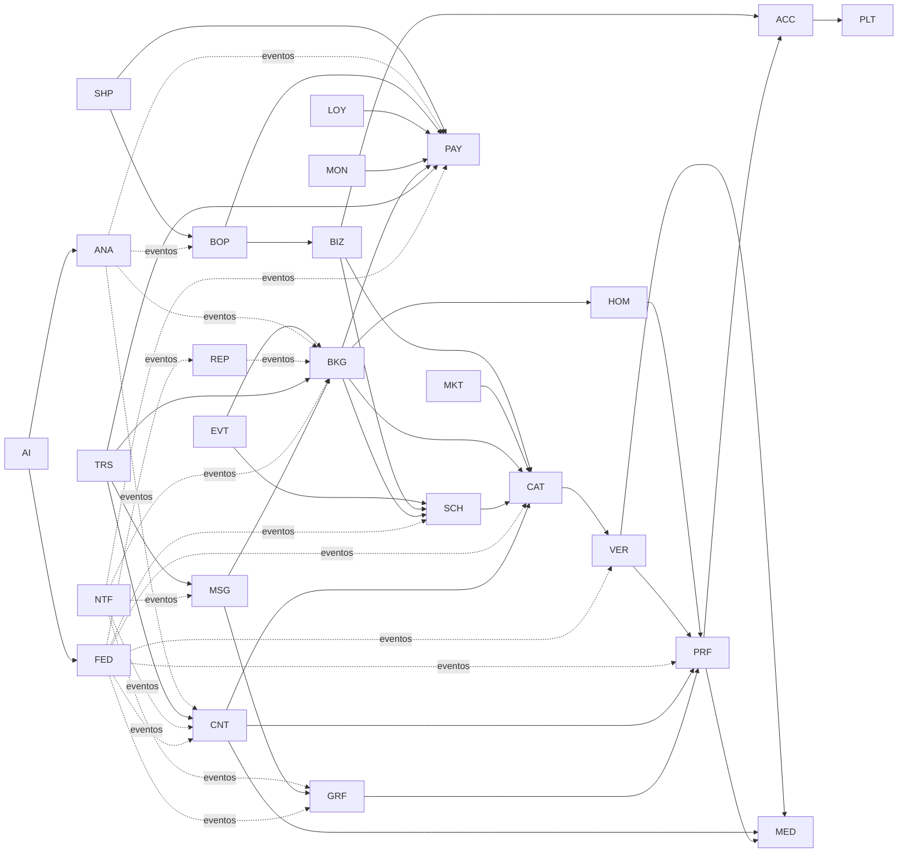

# Owney Beauty — Plan de Desarrollo Backend (Arquitectura + Sprints)

| Campo | Valor |
|---|---|
| Proyecto | Owney Beauty |
| Naturaleza | Empresa real con fines de lucro (República Dominicana). El plan prioriza ingresos, cumplimiento legal/fiscal y operación en producción. |
| Fuente | *Documento Maestro de Producto v1.0* (2026-09-14) |
| Alcance de este plan | Backend modular (ABP 10.6 / .NET 10 / PostgreSQL) + entrega y operación. El frontend se referencia solo donde bloquea al backend. |
| Fecha de corte del estado | 2026-10-08 |
| Duración de sprint | 2 semanas |
| Horizonte | Sprint 0 → Sprint 34 (Fundación → MVP → V1 → V2 → V3) |
| Versión | 2.0 — reestructurado con enfoque de red social |

**Leyenda de estado:** ✅ Hecho · 🟡 Parcial / existe base de plantilla · ⬜ Pendiente
**Prioridad:** MVP · V1 · V2 · V3 (según §18 del documento maestro, con los ajustes indicados en §1.3)

---

## Índice

1. [Resumen y decisiones](#1-resumen-y-decisiones)
2. [Arquitectura objetivo del backend](#2-arquitectura-objetivo-del-backend)
3. [Seguridad por diseño](#3-seguridad-por-diseño)
4. [Escalabilidad y despliegue (Railway)](#4-escalabilidad-y-despliegue-railway)
5. [Mapa de módulos](#5-mapa-de-módulos)
6. [Plan por módulo (Mantenimiento + Funcionalidades)](#6-plan-por-módulo)
7. [Plan de sprints](#7-plan-de-sprints)
8. [Estado actual y deuda técnica inmediata](#8-estado-actual-y-deuda-técnica-inmediata)
9. [Definition of Done del backend](#9-definition-of-done-del-backend)
10. [Cómo mantener este plan](#10-cómo-mantener-este-plan)

---

## 1. Resumen y decisiones

### 1.1 Ciclo crítico que guía la prioridad

```
Descubrir → Reservar → Pagar → Servicio (salón/domicilio) → Liquidar → Reseña
```

Todo lo que no forma parte de este ciclo queda después del MVP.

### 1.2 Decisiones de arquitectura (ADR resumidos)

| # | Decisión | Motivo |
|---|---|---|
| ADR-01 | **Monolito modular** sobre ABP: cada bounded context es un **módulo ABP** con sus propias capas, `DbContext` y esquema PostgreSQL. | §9 y TECH-02-001: límites claros hoy, extracción a servicios mañana sin reescribir. |
| ADR-02 | **Multi-tenancy de ABP desactivada.** Un salón (Owney Business) es una entidad del marketplace, no un tenant. | Los negocios deben ser visibles en Discover junto a profesionales independientes; el tenant aislaría los datos. |
| ADR-03 | Comunicación entre módulos **solo** por *Integration Services* (contratos) y **eventos distribuidos con Outbox/Inbox**. | Evita acoplamiento por tablas; deja la puerta abierta a RabbitMQ sin cambiar código. |
| ADR-04 | Autenticación con OpenIddict usando **Authorization Code + PKCE** (web y móvil). Se retira el *password grant*. | OAuth 2.1 desaconseja el password grant; mejora seguridad y habilita MFA/proveedores externos. |
| ADR-05 | Dinero como `decimal(18,2)` + código de moneda (`DOP`). Ledger de doble entrada. | OB-45-001: no usar un único “Total” como fuente contable. |
| ADR-06 | Fechas en **UTC (`timestamptz`)**; reglas de agenda en hora local del proveedor (`America/Santo_Domingo`). Se elimina `Npgsql.EnableLegacyTimestampBehavior`. | Evita errores de zona horaria en agenda, recordatorios y reportes. |
| ADR-07 | Archivos en **object storage S3-compatible** (p. ej. Cloudflare R2/AWS S3) con URLs firmadas; nunca en PostgreSQL. | §9 y TECH-05: rendimiento, costo y separación KYC privado / contenido público. |
| ADR-08 | Protección financiera mediante proveedor de pagos autorizado (preautorización/captura diferida/payouts), **no escrow propio**. | §13.3 del documento maestro. |
| ADR-09 | Búsqueda inicial con **PostgreSQL (FTS + pg_trgm + PostGIS)** detrás de una interfaz `ISearchIndex`; motor externo solo con evidencia de carga. | Evita arquitectura sobredimensionada (§20). |
| ADR-10 | Proceso **Worker** separado del API (jobs, handlers de eventos, notificaciones). | API stateless y escalable horizontalmente; picos de jobs no afectan latencia. |
| ADR-11 | **Monetización desde el MVP:** comisión por reserva cobrada y facturada (con comprobante fiscal) desde el primer cobro real; planes de suscripción en V1. | Empresa con fines de lucro: el MVP debe validar ingresos, no solo uso. |
| ADR-12 | **Cumplimiento legal y fiscal como trabajo del plan** (módulo LEG), no como tarea posterior. | Pagos, datos personales, KYC y facturación tienen obligaciones legales antes del go-live. |
| ADR-13 | **Red social primero.** Lo social se divide en Perfiles, Grafo Social, Contenido, Feed/Explorar, Mensajería y Notificaciones, y entra al MVP (S3–S5). Las reservas se conectan con “Reservar este look”. | Owney es una red social de belleza; esos módulos tendrán la mayor carga y deben poder escalar por separado. |

### 1.3 Ajustes al roadmap del documento

| Tema | Documento | Plan | Razón |
|---|---|---|---|
| Windows / macOS (Fases 55–56) | MVP | **V2** (S28) | El roadmap §18 ubica “desktop fuerte” en V2; Business/POS también es V2. |
| Android / iOS | MVP | **V1** (S20; MVP = web responsive/PWA) | Reduce el riesgo del MVP; el backend es el mismo. |
| Tracking/ETA (OB-15-002/003) | MVP | **V1** | §18 coloca “tracking Home” en V1. En MVP: estados “en camino / llegó”. |
| MFA (OB-01-005) | V1 | V1, pero **obligatorio para roles admin antes del go-live** | §9: MFA para roles de alto riesgo. |
| Variantes / add-ons | V1 | V1, pero el **snapshot de reserva se diseña desde MVP** para soportarlos | Evita migraciones de datos contractuales. |
| Facturación electrónica (e-CF DGII) | No priorizada | **MVP** (S11) | Owney factura su comisión desde el primer cobro real. |
| Planes de suscripción para profesionales | Solo mencionados (§3.2) | Plan gratuito + límites en **MVP**; cobro de suscripción en **V1** | Segunda fuente de ingreso recurrente. |
| Red social (Owney Social) | V1 | **MVP** (S3–S5) + moderación en MVP | Es el núcleo del producto; Apple/Google exigen reportar y bloquear en apps con contenido de usuarios. |
| Pagos en MVP | “Pago simulado” aceptable | **Proveedor real en producción** (sandbox solo en dev/staging) | Sin cobro real no hay ingreso ni validación del negocio. |

---

## 2. Arquitectura objetivo del backend

### 2.1 Estructura de la solución

Una sola solución ABP 10 por capas (plantilla estándar). **Los módulos no son proyectos aparte**: cada módulo es una carpeta `Modules/<Módulo>` dentro de cada capa (mismo patrón que Voucher Warehouse). Detalle y pasos para crear un módulo: `docs/Owney_Beauty_Estructura_Modulos.md`.

```
Owney Beauty Web API/
├─ src/
│  ├─ Ieh.OwneyBeauty.Domain.Shared        ← Common/ + Modules/<Módulo>/ (consts, errores, Enums/, Events/) + localización única
│  ├─ Ieh.OwneyBeauty.Domain               ← Common/ (Money, GeoPoint…) + Modules/<Módulo>/ (Models/, Managers/, Data/, Settings/)
│  ├─ Ieh.OwneyBeauty.Application.Contracts← Modules/<Módulo>/<Funcionalidad>/ (Dto/, Service/) + permisos del módulo
│  ├─ Ieh.OwneyBeauty.Application          ← Modules/<Módulo>/<Funcionalidad>/ (Service/, Mappers/)
│  ├─ Ieh.OwneyBeauty.EntityFrameworkCore  ← un DbContext + Modules/<Módulo>/<Módulo>ModelBuilderExtensions (esquema por módulo)
│  ├─ Ieh.OwneyBeauty.HttpApi.Host         ← API (stateless); /api/<módulo>/... por convención
│  ├─ Ieh.OwneyBeauty.Infrastructure       ← Redis, OpenTelemetry (compartido por Host y Worker)
│  ├─ Ieh.OwneyBeauty.Worker               ← jobs + outbox/inbox de eventos
│  └─ Ieh.OwneyBeauty.DbMigrator           ← migraciones + seeds
└─ test/
   └─ Ieh.OwneyBeauty.ArchitectureTests    ← reglas entre carpetas de módulos, automatizadas
```

> **Ejemplo:** el módulo Content tendrá `src/Ieh.OwneyBeauty.Domain/Modules/Content/Models/Post.cs`, `src/Ieh.OwneyBeauty.Application.Contracts/Modules/Content/Posts/Dto/PostDto.cs`, `src/Ieh.OwneyBeauty.Application/Modules/Content/Posts/Service/PostAppService.cs`…
>
> **Creación “just-in-time”:** las carpetas de cada módulo se crean cuando su primer sprint empieza. Las APIs salen con *Auto API Controllers* bajo el prefijo del módulo (`/api/content/...`).

### 2.2 Reglas de dependencia (verificadas por `ArchitectureTests`)



1. Un módulo **solo** usa de otro sus constantes, `Enums`, `Events` e `Integration`; nunca sus `Models`, `Managers`, `Service` ni `Mappers`.
2. Lectura síncrona entre módulos → `I<Algo>IntegrationService` en `Modules/<Módulo>/Integration` (atributo `[IntegrationService]`, no expuesto públicamente).
3. Reacciones → **eventos distribuidos** (`*Eto` en `Modules/<Módulo>/Events`) publicados con **Outbox** y consumidos con **Inbox** (idempotente).
4. Un único `DbContext`; cada módulo tiene su **esquema** PostgreSQL (`platform`, `accounts`, `content`…). Entre módulos se guardan **IDs**, no FKs.
5. Datos que otro módulo necesita leer con frecuencia → **proyección local** alimentada por eventos (p. ej. Discover guarda su read model).
6. Toda regla de negocio vive en la entidad o en un *Manager* (domain service); los AppServices solo orquestan.

### 2.3 Convenciones de código

| Tema | Convención |
|---|---|
| Entidades | Aggregate roots con setters privados y métodos de negocio (`booking.Confirm()`), `FullAuditedAggregateRoot<Guid>` cuando aplique. |
| Mapeo | Mapperly (`MapperBase<TOrigen,TDestino>`), una clase por dirección. |
| Validación | Data annotations en DTO + invariantes en dominio (`Check.*`, `BusinessException`). |
| Errores | `BusinessException` con código `Owney.<Módulo>:<Código>` localizado en es/en. |
| Permisos | Un `PermissionDefinitionProvider` por módulo (`Modules/<Módulo>/` en Contracts): `Owney.<Módulo>.<Recurso>.<Acción>`. |
| Paginación | Obligatoria, `MaxResultCount` ≤ 100; cursores para feeds. |
| Concurrencia | `ConcurrencyStamp` de ABP + constraints en BD para invariantes críticas. |
| Idempotencia | Header `Idempotency-Key` en POST de reservas, pagos, reembolsos y payouts. |
| Estados | Máquinas de estado explícitas (tabla de transiciones) + evento por cada transición. |
| Proxies Angular | Siempre generados (`abp generate-proxy`), nunca escritos a mano. |

### 2.4 Flujo de una reserva entre módulos (ejemplo)



---

## 3. Seguridad por diseño

| Área | Control | Historias |
|---|---|---|
| Autenticación | OpenIddict, Authorization Code + PKCE; access token corto (≤15 min); **refresh token rotativo** con revocación; sesiones visibles (`IdentitySession`). | OB-01-004, OB-01-007, OB-47-003/004 |
| MFA | TOTP; obligatorio para Admin, Finanzas, KYC, Soporte, Moderación. | OB-01-005 |
| Autorización (3 capas) | 1) **Permiso** ABP por acción · 2) **Propiedad del recurso** (`IAuthorizationHandler` por agregado: un profesional solo ve sus reservas) · 3) **Ámbito de negocio/sucursal** para empleados (V2). | OB-47-005, OB-30-005 |
| Mínimo privilegio | Roles semilla: Client, Professional, BusinessOwner, Employee, Admin, KycAnalyst, Support, Moderator, Finance, Marketing. Sin auto-escalamiento. | §8.1, OB-30-004 |
| Abuso | ASP.NET Core Rate Limiter: políticas `auth`, `otp`, `write`, `search`; bloqueo progresivo de login. | OB-47-006, OB-01-004 |
| Secretos | Solo variables de entorno de Railway; Data Protection keys persistidas en Redis/BD; cert OpenIddict de producción. | OB-47-007 |
| Datos sensibles | Cifrado de columnas sensibles (nº de cédula, notas privadas) vía `IStringEncryptionService`/value converter; KYC en bucket privado con URL firmada ≤5 min y **auditoría de acceso**. | OB-05-002, OB-14-004 |
| Ubicación | Dirección exacta liberada solo según estado de la reserva; tracking temporal con borrado automático. | OB-14-004, OB-15-003 |
| Pagos | Tokenización (sin PAN/CVV), webhooks con firma verificada + inbox idempotente, idempotencia en cobros/reembolsos. | OB-17-001/002/004 |
| Integridad de agenda | Exclusion constraint PostgreSQL (`btree_gist`) por recurso + rango de tiempo para estados activos: imposible el doble booking aunque falle la app. | OB-11-007 |
| Auditoría | ABP AuditLogging (técnica) + `BusinessAuditEvent` inmutable para pagos, KYC, roles, suspensiones, reembolsos, disputas. | OB-49-001 |
| Transporte y headers | HTTPS, HSTS, `UseAbpSecurityHeaders`, CORS con lista blanca, `App:DisablePII=true` en producción. | OB-47-001 |
| Archivos | Validación de tipo real (magic bytes), tamaño, escaneo antimalware, borrado de EXIF/GPS. | TECH-05-001 |
| Cadena de suministro | Dependency scanning, secret scanning y SAST en cada PR. | QA-01-004, DEVOPS-01-001 |

---

## 4. Escalabilidad y despliegue (Railway)

### 4.1 Topología



| Servicio Railway | Imagen | Notas |
|---|---|---|
| `owney-api` | Dockerfile multi-stage del Host | Escucha en `$PORT`; healthcheck `/health-status`; réplicas horizontales. |
| `owney-worker` | Dockerfile multi-stage del Worker | Sin puerto público; escala aparte. |
| `owney-migrator` | Dockerfile del DbMigrator | Ejecutado como **pre-deploy command** del API. |
| `owney-web` | Dockerfile actual de la UI | nginx con `$PORT`; `dynamic-env.json` por entorno. |
| PostgreSQL | Plugin Railway | Extensiones: `postgis`, `pg_trgm`, `btree_gist`, (`pgvector` en V3). Backups + PITR. |
| Redis | Plugin Railway | Obligatorio desde Sprint 1. |
| Entornos | Railway Environments | `development`, `staging`, `production` (ENV-01). |

### 4.2 Principios de escalabilidad

- **API stateless:** nada en memoria entre requests (cache, locks y backplane en Redis).
- **Trabajo pesado asíncrono:** media, notificaciones, proyecciones de búsqueda, recordatorios → Worker con reintentos y dead-letter.
- **Lecturas calientes cacheadas** (perfil público, catálogo, rating) con invalidación por eventos.
- **Read models** para Discover/Analytics; PostgreSQL transaccional sigue siendo la fuente de verdad.
- **Observabilidad desde el día 1:** Serilog estructurado + OpenTelemetry (traces/metrics) + error tracking + alertas por síntomas de usuario.
- **Extracción futura:** un módulo con carga alta (p. ej. Media, Search, Messaging) se despliega como servicio propio cambiando solo la implementación del event bus y del integration service.

---

## 5. Mapa de módulos

**27 módulos de código + 2 áreas transversales (Operación y Legal) · 420 elementos.** Enfoque: **red social primero**; las reservas, pagos y negocios se conectan a ella mediante “Reservar este look”.

| # | Código | Módulo | Grupo | Esquema BD | Mant. | Func. | Primer sprint |
|---|---|---|---|---|---|---|---|
| M00 | PLT | Plataforma y Shared Kernel | Base | `platform` | 6 | 21 | S0 |
| M01 | ACC | Identidad y Cuentas | Red social | `host + accounts` | 6 | 17 | S2 |
| M02 | PRF | Perfiles | Red social | `profiles` | 4 | 11 | S3 |
| M03 | GRF | Grafo Social | Red social | `social_graph` | 1 | 6 | S3 |
| M04 | CNT | Contenido | Red social | `content` | 3 | 11 | S4 |
| M05 | FED | Feed, Explorar y Búsqueda | Red social | `discovery` | 3 | 12 | S5 |
| M06 | MSG | Mensajería | Red social | `messaging` | 2 | 7 | S12 |
| M07 | NTF | Notificaciones | Red social | `notifications` | 3 | 11 | S5 |
| M08 | MED | Media | Soporte de la red | `media` | 1 | 6 | S3 |
| M09 | TRS | Confianza y Seguridad | Soporte de la red | `trust` | 6 | 15 | S5 |
| M10 | VER | Profesionales y Verificación | Marketplace | `professionals` | 5 | 11 | S6 |
| M11 | CAT | Catálogo de Servicios | Marketplace | `catalog` | 4 | 7 | S7 |
| M12 | SCH | Agenda y Disponibilidad | Marketplace | `scheduling` | 6 | 6 | S7 |
| M13 | BKG | Reservas | Marketplace | `booking` | 5 | 16 | S8 |
| M14 | HOM | Servicio a Domicilio | Marketplace | `home` | 3 | 8 | S9 |
| M15 | REP | Reseñas y Reputación | Marketplace | `reputation` | 3 | 6 | S11 |
| M16 | MKT | Promociones y Precios | Marketplace | `marketing` | 2 | 9 | S18 |
| M17 | PAY | Pagos y Finanzas | Dinero | `payments` | 5 | 16 | S10 |
| M18 | MON | Monetización y Publicidad | Dinero | `billing` | 4 | 8 | S10 |
| M19 | LOY | Wallet y Fidelización | Dinero | `loyalty` | 7 | 12 | S18 |
| M20 | BIZ | Negocios y Equipo | Negocios | `business` | 5 | 9 | S21 |
| M21 | BOP | CRM, POS e Inventario | Negocios | `businessops` | 6 | 17 | S23 |
| M22 | ANA | Analítica | Crecimiento | `analytics` | 1 | 11 | S12 |
| M23 | EVT | Eventos y Squad | Crecimiento | `events` | 1 | 6 | S29 |
| M24 | AI | Inteligencia Artificial | Crecimiento | `ai` | 2 | 8 | S31 |
| M25 | SHP | Tienda de Productos | Crecimiento | `shop` | 2 | 8 | S33 |
| M26 | ADM | Administración y Auditoría | Gobierno | `host + admin` | 3 | 8 | S1 |
| DEV | DEV | Operación, Calidad y Entrega | Áreas transversales | `—` | 6 | 24 | S0 |
| LEG | LEG | Cumplimiento Legal y Fiscal | Áreas transversales | `—` | 1 | 7 | S2 |

### 5.1 Dependencias entre módulos



> Flecha continua: dependencia síncrona por *Integration Service*. Punteada: solo consumo de eventos.
> Módulos con más carga esperada y diseñados para separarse primero: **FED, CNT, MED, MSG, NTF**.

---

## 6. Plan por módulo

Cada módulo se divide en **Mantenimiento** (catálogos, configuraciones, reglas y datos maestros) y **Funcionalidades** (casos de uso).
La prioridad sigue el nivel: MVP = Imprescindible (incluye Fundación), V1 = Esencial, V2 = Expansión, V3 = Visión.

---

### M00 · PLT — Plataforma y Shared Kernel

**Propósito:** Base técnica común: valores compartidos, eventos con outbox, idempotencia, cache, worker, seguridad perimetral y observabilidad. Ningún módulo de negocio se construye sin ella.

**Entidades:** Money, Address, GeoPoint, DateTimeRange, IdempotencyRecord, OutboxMessage, InboxMessage, Province, Municipality, Sector, TaxRate.

#### Mantenimiento

| ID | Elemento | Historias | Prio | Sprint | Estado |
|---|---|---|---|---|---|
| PLT-M01 | Catálogo geográfico RD (provincias, municipios, sectores) | OB-14-001, OB-09-002 | MVP | S1 | 🟡 |
| PLT-M02 | Monedas y formatos (DOP por defecto) | §12 | MVP | S1 | ✅ |
| PLT-M03 | Impuestos (ITBIS) por mercado y vigencia | OB-08-001, OB-33-005 | MVP | S1 | ✅ |
| PLT-M04 | Settings de plataforma por módulo | — | MVP | S1 | ✅ |
| PLT-M05 | Feature flags por módulo | DEVOPS-01-003 | MVP | S1 | 🟡 |
| PLT-M06 | Localización es/en con claves por módulo | §12 | MVP | S0 | ✅ |

#### Funcionalidades

| ID | Elemento | Historias | Prio | Sprint | Estado |
|---|---|---|---|---|---|
| PLT-F01 | Eliminar ejemplo BookStore (código, seeds, tests, tablas) | — | MVP | S0 | ✅ |
| PLT-F02 | Desactivar multi-tenancy y quitar “código de empresa” del login | ADR-02 | MVP | S0 | ✅ |
| PLT-F03 | Secretos fuera del repo + rotar credencial de PostgreSQL | OB-47-007 | MVP | S0 | 🟡 |
| PLT-F04 | Plantilla de módulo + pruebas automáticas de arquitectura | TECH-02-001 | MVP | S0 | ✅ |
| PLT-F05 | Fechas en UTC (timestamptz); quitar modo legacy de Npgsql | ADR-06 | MVP | S0 | ✅ |
| PLT-F06 | Security headers, CORS estricto, PII desactivada en logs | OB-47-001 | MVP | S0 | ✅ |
| PLT-F07 | Shared Kernel (value objects, errores con código) | TECH-01-001 | MVP | S1 | ✅ |
| PLT-F08 | Idempotency-Key en operaciones críticas | OB-17-004, QA-01-002 | MVP | S1 | ✅ |
| PLT-F09 | Event bus distribuido con Outbox/Inbox | TECH-02-001 | MVP | S1 | ✅ |
| PLT-F10 | Redis: cache, locks distribuidos, claves de Data Protection | TECH-03-003 | MVP | S1 | 🟡 |
| PLT-F11 | Proceso Worker + jobs con reintentos y dead-letter | TECH-02-002 | MVP | S1 | ✅ |
| PLT-F12 | Rate limiting por políticas (auth, OTP, escritura, búsqueda) | OB-47-006 | MVP | S1 | ✅ |
| PLT-F13 | OpenAPI y rutas por módulo; versionado de API | TECH-01-001/002 | MVP | S1 | 🟡 |
| PLT-F14 | Logs estructurados + OpenTelemetry + correlation id | TECH-07-001..003 | MVP | S1 | ✅ |
| PLT-F15 | Health checks (BD, Redis, storage) | TECH-07-005 | MVP | S1 | ✅ |
| PLT-F16 | Contadores de alto volumen (likes, seguidores) en Redis con consolidación | OB-10-002 | MVP | S4 | ⬜ |
| PLT-F17 | Canal en tiempo real (SignalR + backplane Redis) | TECH-04-001 | MVP | S12 | ⬜ |
| PLT-F18 | Error tracking + alertas | TECH-07-004/005 | MVP | S13 | ⬜ |
| PLT-F19 | Cache de lecturas calientes con invalidación por eventos | TECH-03-003 | V1 | S20 | ⬜ |
| PLT-F20 | Contrato de sincronización para clientes offline | TECH-03-002, OB-52-001 | V1 | S20 | ⬜ |
| PLT-F21 | Operaciones offline con cola idempotente | OB-52-002 | V2 | S28 | ⬜ |

---

### M01 · ACC — Identidad y Cuentas

**Propósito:** Una identidad con varios roles (cliente, profesional, negocio). Registro, verificación, login seguro, cambio de modo y privacidad de la cuenta.

**Entidades:** IdentityUser (extendido), LegalDocumentVersion, UserConsent, VerificationChallenge, DataExportRequest, AccountDeletionRequest.

#### Mantenimiento

| ID | Elemento | Historias | Prio | Sprint | Estado |
|---|---|---|---|---|---|
| ACC-M01 | Roles del sistema y matriz de permisos | OB-02, §8.1 | MVP | S2 | 🟡 |
| ACC-M02 | Documentos legales versionados (términos, privacidad) | OB-01-001, OB-48-004 | MVP | S2 | ✅ |
| ACC-M03 | Tipos de consentimiento (datos, marketing, ubicación) | OB-48-004 | MVP | S2 | ✅ |
| ACC-M04 | Política de contraseñas y bloqueo | OB-01-004 | MVP | S2 | ✅ |
| ACC-M05 | Plantillas de verificación email/SMS | OB-01-002/003 | MVP | S2 | ✅ |
| ACC-M06 | Proveedores externos (Google/Apple) | OB-01-001 | V1 | S14 | ⬜ |

#### Funcionalidades

| ID | Elemento | Historias | Prio | Sprint | Estado |
|---|---|---|---|---|---|
| ACC-F01 | Registro por email/teléfono con consentimiento | OB-01-001 | MVP | S2 | ✅ |
| ACC-F02 | Verificar correo | OB-01-002 | MVP | S2 | ✅ |
| ACC-F03 | Verificar teléfono (OTP) | OB-01-003 | MVP | S2 | 🟡 |
| ACC-F04 | Login Authorization Code + PKCE (reemplaza password grant) | OB-01-004 | MVP | S2 | 🟡 |
| ACC-F05 | Tokens de corta vida + rotación de refresh tokens | OB-47-003/004 | MVP | S2 | ✅ |
| ACC-F06 | Recuperar contraseña | OB-01-006 | MVP | S2 | 🟡 |
| ACC-F07 | Selección de rol inicial y onboarding | OB-02-001 | MVP | S2 | ✅ |
| ACC-F08 | Cuenta híbrida y cambio de modo sin cerrar sesión | OB-02-002/003 | MVP | S2 | ✅ |
| ACC-F09 | Alertas de seguridad de la cuenta | §13.1 | MVP | S2 | 🟡 |
| ACC-F10 | MFA obligatorio para roles administrativos | OB-01-005 | MVP | S13 | ⬜ |
| ACC-F11 | Gestión de sesiones y dispositivos | OB-01-007 | V1 | S14 | 🟡 |
| ACC-F12 | MFA opcional para todos + recuperación | OB-01-005 | V1 | S14 | ⬜ |
| ACC-F13 | Login con Google/Apple | OB-01-001 | V1 | S14 | ⬜ |
| ACC-F14 | Exportar mis datos | OB-48-001 | V1 | S19 | ⬜ |
| ACC-F15 | Eliminar cuenta (anonimización + retenciones legales) | OB-48-002 | V1 | S19 | ⬜ |
| ACC-F16 | Configurar privacidad y consentimientos | OB-48-003/004 | V1 | S19 | 🟡 |
| ACC-F17 | Gestionar permiso de ubicación | OB-48-005 | V1 | S19 | ⬜ |

---

### M02 · PRF — Perfiles

**Propósito:** Perfil público único con @usuario para clientes, profesionales y negocios. Es la “página” de cada persona en la red: bio, portafolio, servicios destacados, favoritos y Beauty Passport.

**Entidades:** Profile (@handle, tipo, visibilidad), ProfessionalShowcase, PortfolioItem, ClientAddress, Favorite, BeautyPreference, InspirationBoard.

#### Mantenimiento

| ID | Elemento | Historias | Prio | Sprint | Estado |
|---|---|---|---|---|---|
| PRF-M01 | Reglas de @usuario (formato, reservados, frecuencia de cambio) | — | MVP | S3 | ⬜ |
| PRF-M02 | Tipos de cuenta pública (cliente, profesional, negocio) | §8.1 | MVP | S3 | ⬜ |
| PRF-M03 | Tipos de favorito | OB-03-003 | MVP | S9 | ⬜ |
| PRF-M04 | Catálogo de preferencias de belleza | OB-04-002 | V1 | S19 | ⬜ |

#### Funcionalidades

| ID | Elemento | Historias | Prio | Sprint | Estado |
|---|---|---|---|---|---|
| PRF-F01 | Crear/editar perfil (foto, portada, bio, @usuario, enlaces) | OB-03-001, OB-07-001 | MVP | S3 | ⬜ |
| PRF-F02 | Perfil público compartible sin datos privados | OB-07-001 | MVP | S3 | ⬜ |
| PRF-F03 | Cuenta pública o privada | OB-48-003 | MVP | S3 | ⬜ |
| PRF-F04 | Perfil profesional: especialidades, zona aproximada, métricas | OB-07-001 | MVP | S6 | ⬜ |
| PRF-F05 | Portafolio por categorías | OB-07-002 | MVP | S6 | ⬜ |
| PRF-F06 | Direcciones guardadas privadas | OB-03-002 | MVP | S9 | ⬜ |
| PRF-F07 | Favoritos (profesionales, negocios, servicios) | OB-03-003 | MVP | S9 | ⬜ |
| PRF-F08 | Antes/después con consentimiento | OB-07-003 | V1 | S19 | ⬜ |
| PRF-F09 | Beauty Passport: historial de servicios + volver a reservar | OB-04-001 | V1 | S19 | ⬜ |
| PRF-F10 | Preferencias compartibles por reserva | OB-04-002 | V1 | S19 | ⬜ |
| PRF-F11 | Tableros de inspiración | OB-04-003 | V1 | S19 | ⬜ |

---

### M03 · GRF — Grafo Social

**Propósito:** Relaciones entre perfiles: seguir, solicitudes, bloquear y silenciar. Base del feed y de la privacidad.

**Entidades:** Follow, FollowRequest, Block, Mute, FollowCounters (proyección).

#### Mantenimiento

| ID | Elemento | Historias | Prio | Sprint | Estado |
|---|---|---|---|---|---|
| GRF-M01 | Límites anti-spam de seguimiento | OB-47-006 | MVP | S3 | ⬜ |

#### Funcionalidades

| ID | Elemento | Historias | Prio | Sprint | Estado |
|---|---|---|---|---|---|
| GRF-F01 | Seguir / dejar de seguir | OB-10-006 | MVP | S3 | ⬜ |
| GRF-F02 | Solicitudes de seguimiento para cuentas privadas | OB-48-003 | MVP | S3 | ⬜ |
| GRF-F03 | Bloquear usuario (oculta contenido, impide mensajes) | OB-20-006 | MVP | S3 | ⬜ |
| GRF-F04 | Listas de seguidores/seguidos con contadores | OB-10-006 | MVP | S3 | ⬜ |
| GRF-F05 | Silenciar perfiles | — | V1 | S15 | ⬜ |
| GRF-F06 | Sugerencias de a quién seguir | OB-09-005 | V1 | S15 | ⬜ |

---

### M04 · CNT — Contenido

**Propósito:** Publicaciones, interacciones y social commerce. Cada post puede etiquetar servicios y abrir “Reservar este look”.

**Entidades:** Post, PostMedia, Comment, Like, Save, Share, Hashtag, Mention, PostServiceTag, Reel, Story.

#### Mantenimiento

| ID | Elemento | Historias | Prio | Sprint | Estado |
|---|---|---|---|---|---|
| CNT-M01 | Políticas de contenido (longitud, adjuntos, filtros) | OB-10-001 | MVP | S4 | ⬜ |
| CNT-M02 | Hashtags oficiales y bloqueados | — | MVP | S4 | ⬜ |
| CNT-M03 | Caducidad de stories | OB-10-009 | V1 | S14 | ⬜ |

#### Funcionalidades

| ID | Elemento | Historias | Prio | Sprint | Estado |
|---|---|---|---|---|---|
| CNT-F01 | Crear publicación (foto, carrusel, texto) | OB-10-001 | MVP | S4 | ⬜ |
| CNT-F02 | Editar, archivar, eliminar y cerrar comentarios | OB-10-001 | MVP | S4 | ⬜ |
| CNT-F03 | Me gusta | OB-10-002 | MVP | S4 | ⬜ |
| CNT-F04 | Comentarios y respuestas | OB-10-003 | MVP | S4 | ⬜ |
| CNT-F05 | Guardar publicación | OB-10-004 | MVP | S4 | ⬜ |
| CNT-F06 | Compartir (interno y enlace) | OB-10-005 | MVP | S4 | ⬜ |
| CNT-F07 | Hashtags y menciones | — | MVP | S4 | ⬜ |
| CNT-F08 | Etiquetar servicios + “Reservar este look” | OB-10-007 | MVP | S8 | ⬜ |
| CNT-F09 | Reels (video corto) | OB-10-008 | V1 | S14 | ⬜ |
| CNT-F10 | Stories con CTA de reserva | OB-10-009 | V1 | S14 | ⬜ |
| CNT-F11 | Etiquetar productos usados | OB-39-009 | V3 | S34 | ⬜ |

---

### M05 · FED — Feed, Explorar y Búsqueda

**Propósito:** Cómo se descubre el contenido y a los profesionales: feed de seguidos, Explorar, búsqueda de perfiles/hashtags y Discover de profesionales con filtros, mapa y disponibilidad.

**Entidades:** FeedItem, ExploreTopic, ProviderSearchDocument (read model), SearchQueryLog, TrendingTopic.

#### Mantenimiento

| ID | Elemento | Historias | Prio | Sprint | Estado |
|---|---|---|---|---|---|
| FED-M01 | Categorías/temas de Explorar | OB-09-001 | MVP | S5 | ⬜ |
| FED-M02 | Pesos de ranking y etiquetado de publicidad | OB-09-003 | V1 | S15 | ⬜ |
| FED-M03 | Sinónimos y normalización (español dominicano) | TECH-06-001 | V1 | S15 | ⬜ |

#### Funcionalidades

| ID | Elemento | Historias | Prio | Sprint | Estado |
|---|---|---|---|---|---|
| FED-F01 | Feed de seguidos con paginación por cursor | §7 | MVP | S5 | ⬜ |
| FED-F02 | Explorar (populares por categoría y zona) | §7 | MVP | S5 | ⬜ |
| FED-F03 | Buscar perfiles, hashtags y publicaciones | OB-09-001 | MVP | S5 | ⬜ |
| FED-F04 | Read model de profesionales (perfil, servicios, rating, zona) | TECH-06-002 | MVP | S12 | ⬜ |
| FED-F05 | Buscar profesionales/servicios con filtros y orden | OB-09-001..003 | MVP | S12 | ⬜ |
| FED-F06 | Búsqueda geográfica y mapa (ubicación aproximada) | OB-09-004 | MVP | S12 | ⬜ |
| FED-F07 | Filtro de disponibilidad real | OB-09-002 | MVP | S12 | ⬜ |
| FED-F08 | Feed personalizado con ranking | OB-09-005 | V1 | S15 | ⬜ |
| FED-F09 | Tendencias | — | V1 | S15 | ⬜ |
| FED-F10 | Búsqueda en lenguaje natural | TECH-06-001 | V1 | S15 | ⬜ |
| FED-F11 | SEO de perfiles públicos | RELEASE-01-002 | V1 | S20 | ⬜ |
| FED-F12 | Motor de búsqueda externo (si la carga lo exige) | TECH-06-002 | V2 | S28 | ⬜ |

---

### M06 · MSG — Mensajería

**Propósito:** Mensajes directos entre usuarios y chat vinculado a cada reserva, en tiempo real.

**Entidades:** Conversation, ConversationParticipant, Message, MessageAttachment, MessageReceipt, MessageRequest.

#### Mantenimiento

| ID | Elemento | Historias | Prio | Sprint | Estado |
|---|---|---|---|---|---|
| MSG-M01 | Retención y políticas de chat | OB-20-001 | MVP | S12 | ⬜ |
| MSG-M02 | Quién puede escribirme (todos / seguidos) | — | MVP | S12 | ⬜ |

#### Funcionalidades

| ID | Elemento | Historias | Prio | Sprint | Estado |
|---|---|---|---|---|---|
| MSG-F01 | Mensajes directos con solicitudes para no seguidos | — | MVP | S12 | ⬜ |
| MSG-F02 | Chat vinculado a reserva (solo participantes) | OB-20-001 | MVP | S12 | ⬜ |
| MSG-F03 | Mensajes en tiempo real | OB-20-002 | MVP | S12 | ⬜ |
| MSG-F04 | Enviar fotos y compartir publicaciones | OB-20-003 | MVP | S12 | ⬜ |
| MSG-F05 | Mensajes de sistema (confirmación, llegada…) | OB-20-004 | MVP | S12 | ⬜ |
| MSG-F06 | Reportar conversación | OB-20-006 | MVP | S12 | ⬜ |
| MSG-F07 | Confirmación de entrega y lectura | OB-20-005 | V1 | S15 | ⬜ |

---

### M07 · NTF — Notificaciones

**Propósito:** Motor único que convierte eventos en avisos in-app, email, SMS y push, sin duplicados y con deep links.

**Entidades:** Notification, NotificationTemplate, NotificationPreference, DeviceToken, DeliveryLog.

#### Mantenimiento

| ID | Elemento | Historias | Prio | Sprint | Estado |
|---|---|---|---|---|---|
| NTF-M01 | Plantillas por canal e idioma | OB-21 | MVP | S5 | ⬜ |
| NTF-M02 | Preferencias de notificación por usuario | OB-21 | MVP | S5 | ⬜ |
| NTF-M03 | Proveedores email/SMS/push por entorno | §14.2 | MVP | S5 | ⬜ |

#### Funcionalidades

| ID | Elemento | Historias | Prio | Sprint | Estado |
|---|---|---|---|---|---|
| NTF-F01 | Motor evento → plantilla → canal (idempotente, deep link) | OB-21 | MVP | S5 | ⬜ |
| NTF-F02 | Bandeja in-app | §15.1 | MVP | S5 | ⬜ |
| NTF-F03 | Avisos sociales (seguidor, like, comentario, mención) | OB-10 | MVP | S5 | ⬜ |
| NTF-F04 | Reserva confirmada | OB-21-001 | MVP | S11 | ⬜ |
| NTF-F05 | Recordatorio 24 horas antes | OB-21-002 | MVP | S11 | ⬜ |
| NTF-F06 | Cancelación | OB-21-006 | MVP | S11 | ⬜ |
| NTF-F07 | Pago | OB-21-007 | MVP | S11 | ⬜ |
| NTF-F08 | Nuevo mensaje | OB-21-005 | MVP | S12 | ⬜ |
| NTF-F09 | Push (FCM/APNs) | §14.2 | V1 | S15 | ⬜ |
| NTF-F10 | Agrupación de avisos (“X y 5 más”) | — | V1 | S15 | ⬜ |
| NTF-F11 | Recordatorio próximo, en camino, reembolso, promo, waitlist | OB-21-003/004/008/009/010 | V1 | S16 | ⬜ |

---

### M08 · MED — Media

**Propósito:** Subida, validación, procesamiento y entrega de fotos, videos y documentos. KYC en almacenamiento privado; contenido social por CDN.

**Entidades:** MediaAsset (propósito, visibilidad, estado), MediaVariant.

#### Mantenimiento

| ID | Elemento | Historias | Prio | Sprint | Estado |
|---|---|---|---|---|---|
| MED-M01 | Políticas por propósito (tipos, tamaño, retención, visibilidad) | §15.2 | MVP | S3 | ⬜ |

#### Funcionalidades

| ID | Elemento | Historias | Prio | Sprint | Estado |
|---|---|---|---|---|---|
| MED-F01 | Subida directa con URL firmada a S3/R2 | TECH-05-001 | MVP | S3 | ⬜ |
| MED-F02 | Validación de tipo real, tamaño y antimalware | TECH-05-001 | MVP | S3 | ⬜ |
| MED-F03 | Almacenamiento privado (KYC) vs público + CDN | §15.2 | MVP | S3 | ⬜ |
| MED-F04 | Miniaturas, formatos modernos, eliminar EXIF/GPS | TECH-05-002 | MVP | S4 | ⬜ |
| MED-F05 | Borrado coherente con retención | TECH-05-002 | MVP | S13 | ⬜ |
| MED-F06 | Pipeline de video (transcodificación, streaming) | §15.2 | V1 | S14 | ⬜ |

---

### M09 · TRS — Confianza y Seguridad

**Propósito:** Moderación de contenido (requisito de Apple/Google para apps con contenido de usuarios), disputas de reservas (Owney Protect) y soporte.

**Entidades:** ContentReport, ModerationCase, ModerationAction, AccountSanction, Dispute, DisputeEvidence, Appeal, SupportTicket, HelpArticle.

#### Mantenimiento

| ID | Elemento | Historias | Prio | Sprint | Estado |
|---|---|---|---|---|---|
| TRS-M01 | Motivos de reporte | OB-43-001 | MVP | S5 | ⬜ |
| TRS-M02 | Términos prohibidos y filtros automáticos | OB-22-003 | MVP | S5 | ⬜ |
| TRS-M03 | Motivos de disputa | OB-19-001 | V1 | S17 | ⬜ |
| TRS-M04 | Tipos de resolución de disputa | OB-19-004 | V1 | S17 | ⬜ |
| TRS-M05 | Categorías y SLA de tickets | OB-44-002/003 | V1 | S14 | ⬜ |
| TRS-M06 | Artículos del centro de ayuda | OB-44-001 | V1 | S14 | ⬜ |

#### Funcionalidades

| ID | Elemento | Historias | Prio | Sprint | Estado |
|---|---|---|---|---|---|
| TRS-F01 | Reportar publicación, comentario, perfil o mensaje | OB-43-001 | MVP | S5 | ⬜ |
| TRS-F02 | Cola de moderación | OB-43-002 | MVP | S5 | ⬜ |
| TRS-F03 | Ocultar/eliminar contenido | OB-43-003 | MVP | S5 | ⬜ |
| TRS-F04 | Advertir/suspender cuenta | OB-43-004 | MVP | S5 | ⬜ |
| TRS-F05 | Filtro automático de texto | OB-22-003 | MVP | S5 | ⬜ |
| TRS-F06 | Reportar problema de una reserva | OB-19-001 | V1 | S17 | ⬜ |
| TRS-F07 | Adjuntar evidencia | OB-19-002 | V1 | S17 | ⬜ |
| TRS-F08 | Centro de disputa (timeline) | OB-19-003 | V1 | S17 | ⬜ |
| TRS-F09 | Resolver disputa con acción financiera | OB-19-004 | V1 | S17 | ⬜ |
| TRS-F10 | Apelar resolución | OB-19-005 | V1 | S17 | ⬜ |
| TRS-F11 | Apelación de moderación | OB-43 | V1 | S19 | ⬜ |
| TRS-F12 | Centro de ayuda | OB-44-001 | V1 | S14 | ⬜ |
| TRS-F13 | Crear ticket con contexto | OB-44-002 | V1 | S14 | ⬜ |
| TRS-F14 | Gestionar tickets (asignar, escalar, SLA) | OB-44-003 | V1 | S14 | ⬜ |
| TRS-F15 | Moderación automática de imágenes | — | V2 | S28 | ⬜ |

---

### M10 · VER — Profesionales y Verificación

**Propósito:** Habilitar a un usuario como profesional: solicitud, documentos KYC, revisión administrativa e insignias de confianza.

**Entidades:** ProfessionalApplication, KycDocument (versionado), KycReviewDecision, Specialty, Certification, Badge.

#### Mantenimiento

| ID | Elemento | Historias | Prio | Sprint | Estado |
|---|---|---|---|---|---|
| VER-M01 | Especialidades | OB-05-001 | MVP | S6 | ⬜ |
| VER-M02 | Tipos de documento KYC | OB-05-002 | MVP | S6 | ⬜ |
| VER-M03 | Checklist de revisión KYC | OB-42-002 | MVP | S6 | ⬜ |
| VER-M04 | Motivos de rechazo / solicitud de información | OB-42-003 | MVP | S6 | ⬜ |
| VER-M05 | Criterios de insignias | OB-06-002/003 | V1 | S19 | ⬜ |

#### Funcionalidades

| ID | Elemento | Historias | Prio | Sprint | Estado |
|---|---|---|---|---|---|
| VER-F01 | Solicitar cuenta profesional (borrador) | OB-05-001 | MVP | S6 | ⬜ |
| VER-F02 | Cargar documentos (validación, cifrado, versiones) | OB-05-002 | MVP | S6 | ⬜ |
| VER-F03 | Estados KYC (Draft → Verified/Rejected/Suspended) | OB-05-003 | MVP | S6 | ⬜ |
| VER-F04 | Responder solicitud de información | OB-05-004 | MVP | S6 | ⬜ |
| VER-F05 | Cola de verificaciones (filtros, SLA) | OB-42-001 | MVP | S6 | ⬜ |
| VER-F06 | Revisión con visor seguro y auditoría | OB-42-002 | MVP | S6 | ⬜ |
| VER-F07 | Aprobar / pedir información / rechazar / suspender | OB-42-003 | MVP | S6 | ⬜ |
| VER-F08 | Insignia de identidad verificada | OB-06-001 | MVP | S6 | ⬜ |
| VER-F09 | Regla “reservable” (verificado + servicio + horario) | §11.2 | MVP | S8 | ⬜ |
| VER-F10 | Insignia profesional por certificaciones | OB-06-002 | V1 | S19 | ⬜ |
| VER-F11 | Owney Verified Pro | OB-06-003 | V2 | S28 | ⬜ |

---

### M11 · CAT — Catálogo de Servicios

**Propósito:** Servicios reservables con precio, duración, modalidad (salón/domicilio) y políticas.

**Entidades:** ServiceCategory, Service, ServiceVariant, ServiceAddon, CancellationPolicy, DepositPolicy.

#### Mantenimiento

| ID | Elemento | Historias | Prio | Sprint | Estado |
|---|---|---|---|---|---|
| CAT-M01 | Categorías de servicio | OB-08-001 | MVP | S7 | ⬜ |
| CAT-M02 | Políticas de cancelación/reprogramación | OB-12-008/009 | MVP | S7 | ⬜ |
| CAT-M03 | Políticas de depósito | OB-17-003 | MVP | S7 | ⬜ |
| CAT-M04 | Modalidades (salón, domicilio, ambos) | OB-08-004 | MVP | S7 | ⬜ |

#### Funcionalidades

| ID | Elemento | Historias | Prio | Sprint | Estado |
|---|---|---|---|---|---|
| CAT-F01 | Crear servicio (borrador/activo/inactivo) | OB-08-001 | MVP | S7 | ⬜ |
| CAT-F02 | Modalidad y reglas de ubicación | OB-08-004 | MVP | S7 | ⬜ |
| CAT-F03 | Asignar políticas e impuestos | OB-08-001 | MVP | S7 | ⬜ |
| CAT-F04 | Publicar servicio | §14.3 | MVP | S7 | ⬜ |
| CAT-F05 | Snapshot inmutable para reservas | OB-08-002 | MVP | S8 | ⬜ |
| CAT-F06 | Variantes | OB-08-002 | V1 | S16 | ⬜ |
| CAT-F07 | Add-ons | OB-08-003 | V1 | S16 | ⬜ |

---

### M12 · SCH — Agenda y Disponibilidad

**Propósito:** Horarios, ausencias y bloqueos; motor que calcula slots reales y evita la doble reserva.

**Entidades:** ResourceSchedule, WorkingHoursRule, TimeOff, CalendarBlock, BufferSettings.

#### Mantenimiento

| ID | Elemento | Historias | Prio | Sprint | Estado |
|---|---|---|---|---|---|
| SCH-M01 | Horario laboral semanal | OB-11-001 | MVP | S7 | ⬜ |
| SCH-M02 | Días libres | OB-11-002 | MVP | S7 | ⬜ |
| SCH-M03 | Vacaciones | OB-11-003 | MVP | S7 | ⬜ |
| SCH-M04 | Bloqueos internos | OB-11-004 | MVP | S7 | ⬜ |
| SCH-M05 | Antelación mínima/máxima | OB-12-003 | MVP | S7 | ⬜ |
| SCH-M06 | Buffers | OB-11-006 | V1 | S16 | ⬜ |

#### Funcionalidades

| ID | Elemento | Historias | Prio | Sprint | Estado |
|---|---|---|---|---|---|
| SCH-F01 | Motor de disponibilidad | OB-11-005, OB-12-004 | MVP | S8 | ⬜ |
| SCH-F02 | Prevención de doble reserva (lock + constraint en BD) | OB-11-007 | MVP | S8 | ⬜ |
| SCH-F03 | Calendario día/semana/mes/lista | OB-11-008 | MVP | S8 | ⬜ |
| SCH-F04 | Conflictos al cambiar horario o vacaciones | OB-11-002/003 | MVP | S9 | ⬜ |
| SCH-F05 | Capacidad mayor a 1 | OB-11-007 | V2 | S22 | ⬜ |
| SCH-F06 | Agenda por empleado y sucursal | OB-31-004 | V2 | S22 | ⬜ |

---

### M13 · BKG — Reservas

**Propósito:** Cotización, confirmación, cambios, cancelación y ciclo del servicio con evidencia; lista de espera.

**Entidades:** Booking (snapshot contractual), BookingQuote, BookingStatusEvent, ServiceStartPin, WaitlistEntry, RecurringSeries.

#### Mantenimiento

| ID | Elemento | Historias | Prio | Sprint | Estado |
|---|---|---|---|---|---|
| BKG-M01 | Estados y transiciones | Apéndice C | MVP | S8 | ⬜ |
| BKG-M02 | Numeración de reservas | OB-12-007 | MVP | S8 | ⬜ |
| BKG-M03 | Motivos de cancelación | OB-12-009 | MVP | S9 | ⬜ |
| BKG-M04 | Parámetros de auto-completado y no-show | §19 | MVP | S11 | ⬜ |
| BKG-M05 | Parámetros de lista de espera | OB-13-003 | V1 | S16 | ⬜ |

#### Funcionalidades

| ID | Elemento | Historias | Prio | Sprint | Estado |
|---|---|---|---|---|---|
| BKG-F01 | Motor de precio (base → extras → promo → traslado → impuestos → depósito) | OB-12-006 | MVP | S8 | ⬜ |
| BKG-F02 | Cotizar: servicio, profesional, fecha, hora, modalidad | OB-12-001..006 | MVP | S8 | ⬜ |
| BKG-F03 | Confirmar reserva (idempotente, snapshot) | OB-12-007 | MVP | S8 | ⬜ |
| BKG-F04 | Evidencia operacional por transición | OB-16-003 | MVP | S8 | ⬜ |
| BKG-F05 | Origen de la reserva (post, story, perfil) para atribución | OB-10-007 | MVP | S8 | ⬜ |
| BKG-F06 | Mis citas / agenda del profesional | §5 | MVP | S9 | ⬜ |
| BKG-F07 | Reprogramar | OB-12-008 | MVP | S9 | ⬜ |
| BKG-F08 | Cancelar con penalización/reembolso | OB-12-009 | MVP | S9 | ⬜ |
| BKG-F09 | Ciclo: preparando → en camino → llegó → en curso → completado | OB-16 | MVP | S11 | ⬜ |
| BKG-F10 | Inicio con PIN | OB-16-001 | MVP | S11 | ⬜ |
| BKG-F11 | Finalizar y confirmar servicio | OB-16-002 | MVP | S11 | ⬜ |
| BKG-F12 | Marcar no-show | §19 | MVP | S11 | ⬜ |
| BKG-F13 | Unirse a lista de espera | OB-13-001 | V1 | S16 | ⬜ |
| BKG-F14 | Notificar slot liberado | OB-13-002 | V1 | S16 | ⬜ |
| BKG-F15 | Ventana de prioridad | OB-13-003 | V1 | S16 | ⬜ |
| BKG-F16 | Reservas recurrentes | OB-12-010 | V2 | S28 | ⬜ |

---

### M14 · HOM — Servicio a Domicilio

**Propósito:** Cobertura, cálculo transparente del traslado, protección de la dirección y estados del desplazamiento.

**Entidades:** CoverageZone, TravelFeeRule, TravelQuote, AddressAccessLog, TrackingSession.

#### Mantenimiento

| ID | Elemento | Historias | Prio | Sprint | Estado |
|---|---|---|---|---|---|
| HOM-M01 | Zonas de cobertura | OB-14-001 | MVP | S9 | ⬜ |
| HOM-M02 | Reglas de tarifa de traslado | OB-14-002 | MVP | S9 | ⬜ |
| HOM-M03 | Proveedor de mapas (límites, fallback) | §14.2 | MVP | S9 | ⬜ |

#### Funcionalidades

| ID | Elemento | Historias | Prio | Sprint | Estado |
|---|---|---|---|---|---|
| HOM-F01 | Validar dirección contra cobertura | OB-14-001 | MVP | S9 | ⬜ |
| HOM-F02 | Calcular traslado y guardar desglose | OB-14-002 | MVP | S9 | ⬜ |
| HOM-F03 | Precio transparente (estimado vs definitivo) | OB-14-003 | MVP | S9 | ⬜ |
| HOM-F04 | Proteger dirección exacta | OB-14-004 | MVP | S9 | ⬜ |
| HOM-F05 | Marcar “en camino” | OB-15-001 | MVP | S11 | ⬜ |
| HOM-F06 | Marcar llegada | OB-15-004 | MVP | S11 | ⬜ |
| HOM-F07 | Tracking temporal | OB-15-003 | V1 | S16 | ⬜ |
| HOM-F08 | ETA | OB-15-002 | V1 | S16 | ⬜ |

---

### M15 · REP — Reseñas y Reputación

**Propósito:** Reseñas solo de servicios completados y reputación pública confiable.

**Entidades:** Review, ReviewDimensionScore, ReviewResponse, ReputationSnapshot.

#### Mantenimiento

| ID | Elemento | Historias | Prio | Sprint | Estado |
|---|---|---|---|---|---|
| REP-M01 | Política de edición/retiro de reseñas | OB-22-001 | MVP | S11 | ⬜ |
| REP-M02 | Dimensiones de calificación | OB-22-002 | V1 | S19 | ⬜ |
| REP-M03 | Muestra mínima para métricas | OB-22-005 | V1 | S19 | ⬜ |

#### Funcionalidades

| ID | Elemento | Historias | Prio | Sprint | Estado |
|---|---|---|---|---|---|
| REP-F01 | Reseña verificada | OB-22-001 | MVP | S11 | ⬜ |
| REP-F02 | Comentario de reseña moderado | OB-22-003 | MVP | S11 | ⬜ |
| REP-F03 | Rating agregado | OB-22-005 | MVP | S11 | ⬜ |
| REP-F04 | Valoración multidimensional | OB-22-002 | V1 | S19 | ⬜ |
| REP-F05 | Respuesta del profesional | OB-22-004 | V1 | S19 | ⬜ |
| REP-F06 | Métricas públicas (puntualidad, cancelación) | OB-22-005 | V1 | S19 | ⬜ |

---

### M16 · MKT — Promociones y Precios

**Propósito:** Promociones, cupones, flash sales y precios dinámicos opcionales.

**Entidades:** Promotion, PromotionRule, Coupon, CouponRedemption, FlashSale, PricingRule.

#### Mantenimiento

| ID | Elemento | Historias | Prio | Sprint | Estado |
|---|---|---|---|---|---|
| MKT-M01 | Límites globales de descuento | OB-23-001 | V1 | S18 | ⬜ |
| MKT-M02 | Reglas de Smart Pricing | OB-24 | V3 | S31 | ⬜ |

#### Funcionalidades

| ID | Elemento | Historias | Prio | Sprint | Estado |
|---|---|---|---|---|---|
| MKT-F01 | Crear promoción | OB-23-001 | V1 | S18 | ⬜ |
| MKT-F02 | Vigencia | OB-23-002 | V1 | S18 | ⬜ |
| MKT-F03 | Servicios aplicables | OB-23-003 | V1 | S18 | ⬜ |
| MKT-F04 | Límite de usos | OB-23-004 | V1 | S18 | ⬜ |
| MKT-F05 | Cupones | OB-23-005 | V1 | S18 | ⬜ |
| MKT-F06 | Flash sale | OB-23-006 | V1 | S18 | ⬜ |
| MKT-F07 | Precio para baja demanda | OB-24-001 | V3 | S31 | ⬜ |
| MKT-F08 | Precio para alta demanda | OB-24-002 | V3 | S31 | ⬜ |
| MKT-F09 | Transparencia del ajuste | OB-24-003 | V3 | S31 | ⬜ |

---

### M17 · PAY — Pagos y Finanzas

**Propósito:** Cobros reales con proveedor autorizado, comisión, ledger de doble entrada, reembolsos y payouts. Sin escrow propio.

**Entidades:** PaymentMethod, PaymentIntent, PaymentTransaction, LedgerEntry, PlatformFeeRule, Receipt, Refund, Payout, WebhookInbox.

#### Mantenimiento

| ID | Elemento | Historias | Prio | Sprint | Estado |
|---|---|---|---|---|---|
| PAY-M01 | Proveedor de pagos por entorno | §14.2, §13.3 | MVP | S10 | ⬜ |
| PAY-M02 | Reglas de comisión Owney | OB-17-006 | MVP | S10 | ⬜ |
| PAY-M03 | Plan de cuentas del ledger | OB-45-001 | MVP | S10 | ⬜ |
| PAY-M04 | Montos sugeridos de propina | OB-17-007 | V1 | S17 | ⬜ |
| PAY-M05 | Reglas y calendario de payouts | OB-46 | V1 | S18 | ⬜ |

#### Funcionalidades

| ID | Elemento | Historias | Prio | Sprint | Estado |
|---|---|---|---|---|---|
| PAY-F01 | Integración con proveedor real (sandbox en dev/staging) | §14.2 | MVP | S10 | ⬜ |
| PAY-F02 | Método de pago tokenizado | OB-17-001/002 | MVP | S10 | ⬜ |
| PAY-F03 | Depósito | OB-17-003 | MVP | S10 | ⬜ |
| PAY-F04 | Pago completo sin doble cobro | OB-17-004 | MVP | S10 | ⬜ |
| PAY-F05 | Webhooks firmados e idempotentes | OB-17-004 | MVP | S10 | ⬜ |
| PAY-F06 | Cálculo y desglose de comisión | OB-17-006, OB-45-001 | MVP | S10 | ⬜ |
| PAY-F07 | Ledger de doble entrada | OB-45-001 | MVP | S10 | ⬜ |
| PAY-F08 | Recibo | OB-17-008 | MVP | S11 | ⬜ |
| PAY-F09 | Reembolsos parcial/total | OB-45-003 | MVP | S13 | ⬜ |
| PAY-F10 | Autorización y captura diferida | OB-17-005 | V1 | S17 | ⬜ |
| PAY-F11 | Propinas | OB-17-007 | V1 | S17 | ⬜ |
| PAY-F12 | Conciliación con el proveedor | OB-45-002 | V1 | S17 | ⬜ |
| PAY-F13 | Cuenta de cobro del profesional | OB-46-001 | V1 | S18 | ⬜ |
| PAY-F14 | Balance del profesional | OB-46-002 | V1 | S18 | ⬜ |
| PAY-F15 | Procesar payouts | OB-46-003 | V1 | S18 | ⬜ |
| PAY-F16 | Historial de payouts | OB-46-004 | V1 | S18 | ⬜ |

---

### M18 · MON — Monetización y Publicidad

**Propósito:** Cómo gana dinero Owney: comisión facturada con comprobante fiscal, planes para profesionales y publicidad (destacados y posts promocionados).

**Entidades:** SubscriptionPlan, PlanEntitlement, ProviderSubscription, OwneyInvoice, FiscalSequence, ElectronicFiscalDocument, PromotedListing, PostBoost.

#### Mantenimiento

| ID | Elemento | Historias | Prio | Sprint | Estado |
|---|---|---|---|---|---|
| MON-M01 | Planes para profesionales/negocios (Gratis/Pro/Business) | §3.2 | MVP | S10 | ⬜ |
| MON-M02 | Comisión por plan | OB-17-006 | MVP | S10 | ⬜ |
| MON-M03 | Datos fiscales de Owney y secuencias NCF/e-CF | DGII | MVP | S10 | ⬜ |
| MON-M04 | Productos de publicidad (destacados, posts promocionados) | §3.2 | V1 | S20 | ⬜ |

#### Funcionalidades

| ID | Elemento | Historias | Prio | Sprint | Estado |
|---|---|---|---|---|---|
| MON-F01 | Plan gratuito por defecto y límites por plan | §3.2 | MVP | S10 | ⬜ |
| MON-F02 | Facturar la comisión al profesional | OB-17-006, OB-45-001 | MVP | S11 | ⬜ |
| MON-F03 | Emitir e-CF con proveedor certificado DGII | DGII | MVP | S11 | ⬜ |
| MON-F04 | Reporte de ingresos (GMV, take rate, MRR) | §19 | MVP | S12 | ⬜ |
| MON-F05 | Exportación contable | OB-45-002 | V1 | S17 | ⬜ |
| MON-F06 | Suscripción de pago (renovación, cambio de plan, reintentos) | §3.2 | V1 | S18 | ⬜ |
| MON-F07 | Perfiles destacados en Discover (etiquetados) | OB-09-003 | V1 | S20 | ⬜ |
| MON-F08 | Promocionar publicaciones (boost) | §3.2 | V1 | S20 | ⬜ |

---

### M19 · LOY — Wallet y Fidelización

**Propósito:** Créditos, gift cards, puntos, niveles, referidos, membresías y paquetes.

**Entidades:** WalletAccount, WalletTransaction, GiftCard, RewardAccount, Tier, Referral, MembershipPlan, PackageDefinition.

#### Mantenimiento

| ID | Elemento | Historias | Prio | Sprint | Estado |
|---|---|---|---|---|---|
| LOY-M01 | Tipos de crédito y expiración | OB-18 | V1 | S18 | ⬜ |
| LOY-M02 | Denominaciones de gift card | OB-18-003 | V1 | S18 | ⬜ |
| LOY-M03 | Reglas de puntos | OB-25-001/002 | V2 | S23 | ⬜ |
| LOY-M04 | Niveles Beauty/Glow/Gold/Platinum | OB-25-004 | V2 | S23 | ⬜ |
| LOY-M05 | Reglas de referidos | OB-25-003 | V2 | S23 | ⬜ |
| LOY-M06 | Planes de membresía | OB-26-001 | V2 | S24 | ⬜ |
| LOY-M07 | Paquetes de servicios | OB-27-001 | V2 | S24 | ⬜ |

#### Funcionalidades

| ID | Elemento | Historias | Prio | Sprint | Estado |
|---|---|---|---|---|---|
| LOY-F01 | Historial del wallet | OB-18-001 | V1 | S18 | ⬜ |
| LOY-F02 | Aplicar crédito | OB-18-002 | V1 | S18 | ⬜ |
| LOY-F03 | Gift cards | OB-18-003 | V1 | S18 | ⬜ |
| LOY-F04 | Canje de cupones | OB-18-004 | V1 | S18 | ⬜ |
| LOY-F05 | Acumular puntos | OB-25-001 | V2 | S23 | ⬜ |
| LOY-F06 | Canjear puntos | OB-25-002 | V2 | S23 | ⬜ |
| LOY-F07 | Referidos | OB-25-003 | V2 | S23 | ⬜ |
| LOY-F08 | Consultar nivel | OB-25-004 | V2 | S23 | ⬜ |
| LOY-F09 | Suscribirse a membresía | OB-26-002 | V2 | S24 | ⬜ |
| LOY-F10 | Comprar paquete | OB-27-001 | V2 | S24 | ⬜ |
| LOY-F11 | Consumir paquete | OB-27-002 | V2 | S24 | ⬜ |
| LOY-F12 | Balance de paquete | OB-27-003 | V2 | S24 | ⬜ |

---

### M20 · BIZ — Negocios y Equipo

**Propósito:** Salones, spas y barberías con sucursales, empleados, roles, turnos y comisiones.

**Entidades:** Business, Branch, EmployeeMembership, BusinessRole, Invitation, Shift, Absence, CommissionRule.

#### Mantenimiento

| ID | Elemento | Historias | Prio | Sprint | Estado |
|---|---|---|---|---|---|
| BIZ-M01 | Tipos de negocio | OB-30-001 | V2 | S21 | ⬜ |
| BIZ-M02 | Sucursales | OB-30-002 | V2 | S21 | ⬜ |
| BIZ-M03 | Roles de negocio | OB-30-004 | V2 | S21 | ⬜ |
| BIZ-M04 | Matriz de permisos | OB-30-005 | V2 | S21 | ⬜ |
| BIZ-M05 | Reglas de comisión de empleados | OB-35-001 | V2 | S27 | ⬜ |

#### Funcionalidades

| ID | Elemento | Historias | Prio | Sprint | Estado |
|---|---|---|---|---|---|
| BIZ-F01 | Crear negocio | OB-30-001 | V2 | S21 | ⬜ |
| BIZ-F02 | Invitar empleados | OB-30-003 | V2 | S21 | ⬜ |
| BIZ-F03 | Autorización por negocio/sucursal | OB-30-005 | V2 | S21 | ⬜ |
| BIZ-F04 | Turnos | OB-31-001 | V2 | S22 | ⬜ |
| BIZ-F05 | Vacaciones del personal | OB-31-002 | V2 | S22 | ⬜ |
| BIZ-F06 | Ausencias | OB-31-003 | V2 | S22 | ⬜ |
| BIZ-F07 | Disponibilidad por empleado / “cualquiera” | OB-31-004, OB-12-002 | V2 | S22 | ⬜ |
| BIZ-F08 | Calcular comisiones | OB-35-002 | V2 | S27 | ⬜ |
| BIZ-F09 | Reportar comisiones | OB-35-003 | V2 | S27 | ⬜ |

---

### M21 · BOP — CRM, POS e Inventario

**Propósito:** Operación diaria del salón: clientes, caja/punto de venta e inventario.

**Entidades:** CustomerRecord, Segment, PosOrder, PosLine, CashRegisterSession, Product, InventoryMovement.

#### Mantenimiento

| ID | Elemento | Historias | Prio | Sprint | Estado |
|---|---|---|---|---|---|
| BOP-M01 | Reglas de rebooking | OB-32-003 | V2 | S23 | ⬜ |
| BOP-M02 | Cajas por sucursal | OB-33-008 | V2 | S25 | ⬜ |
| BOP-M03 | Métodos de pago POS | OB-33-006 | V2 | S25 | ⬜ |
| BOP-M04 | Productos | OB-34-001 | V2 | S26 | ⬜ |
| BOP-M05 | Mínimos de stock | OB-34-006 | V2 | S26 | ⬜ |
| BOP-M06 | Consumo de insumos por servicio | OB-34-007 | V2 | S26 | ⬜ |

#### Funcionalidades

| ID | Elemento | Historias | Prio | Sprint | Estado |
|---|---|---|---|---|---|
| BOP-F01 | Ficha de cliente | OB-32-001 | V2 | S23 | ⬜ |
| BOP-F02 | Segmentación de clientes | OB-32-002 | V2 | S23 | ⬜ |
| BOP-F03 | Sugerir rebooking | OB-32-003 | V2 | S23 | ⬜ |
| BOP-F04 | POS: crear venta | OB-33-001 | V2 | S25 | ⬜ |
| BOP-F05 | POS: añadir servicio | OB-33-002 | V2 | S25 | ⬜ |
| BOP-F06 | POS: añadir producto | OB-33-003 | V2 | S25 | ⬜ |
| BOP-F07 | POS: aplicar descuento | OB-33-004 | V2 | S25 | ⬜ |
| BOP-F08 | POS: calcular impuestos | OB-33-005 | V2 | S25 | ⬜ |
| BOP-F09 | POS: cobrar | OB-33-006 | V2 | S25 | ⬜ |
| BOP-F10 | POS: recibo | OB-33-007 | V2 | S25 | ⬜ |
| BOP-F11 | POS: cerrar caja | OB-33-008 | V2 | S25 | ⬜ |
| BOP-F12 | Existencias por sucursal | OB-34-002 | V2 | S26 | ⬜ |
| BOP-F13 | Entradas | OB-34-003 | V2 | S26 | ⬜ |
| BOP-F14 | Salidas | OB-34-004 | V2 | S26 | ⬜ |
| BOP-F15 | Ajustes | OB-34-005 | V2 | S26 | ⬜ |
| BOP-F16 | Alerta de bajo inventario | OB-34-006 | V2 | S26 | ⬜ |
| BOP-F17 | Consumo por servicio | OB-34-007 | V2 | S26 | ⬜ |

---

### M22 · ANA — Analítica

**Propósito:** Métricas con definición única para Owney, profesionales, negocios y creadores de contenido.

**Entidades:** MetricDefinition, AnalyticsEvent, ProviderDailyStats, ContentStats.

#### Mantenimiento

| ID | Elemento | Historias | Prio | Sprint | Estado |
|---|---|---|---|---|---|
| ANA-M01 | Diccionario de métricas | PROD-01-002 | MVP | S12 | ⬜ |

#### Funcionalidades

| ID | Elemento | Historias | Prio | Sprint | Estado |
|---|---|---|---|---|---|
| ANA-F01 | Eventos analíticos críticos | PROD-01-002 | MVP | S12 | ⬜ |
| ANA-F02 | Resumen básico del profesional | §5 | MVP | S12 | ⬜ |
| ANA-F03 | Métricas de contenido (alcance, interacción, contenido → reserva) | §19 Social | V1 | S20 | ⬜ |
| ANA-F04 | Ingresos | OB-36-001 | V2 | S27 | ⬜ |
| ANA-F05 | Reservaciones | OB-36-002 | V2 | S27 | ⬜ |
| ANA-F06 | Ticket promedio | OB-36-003 | V2 | S27 | ⬜ |
| ANA-F07 | Ocupación | OB-36-004 | V2 | S27 | ⬜ |
| ANA-F08 | Cancelaciones y no-show | OB-36-005 | V2 | S27 | ⬜ |
| ANA-F09 | Clientes nuevos y recurrentes | OB-36-006 | V2 | S27 | ⬜ |
| ANA-F10 | Servicios más vendidos | OB-36-007 | V2 | S27 | ⬜ |
| ANA-F11 | Horarios más rentables | OB-36-008 | V2 | S27 | ⬜ |

---

### M23 · EVT — Eventos y Squad

**Propósito:** Bodas, quinceañeras y eventos grupales con varios participantes y profesionales.

**Entidades:** Event, EventParticipant, EventServiceAssignment, EventScheduleItem, SquadProposal.

#### Mantenimiento

| ID | Elemento | Historias | Prio | Sprint | Estado |
|---|---|---|---|---|---|
| EVT-M01 | Tipos de evento | OB-28-001 | V3 | S29 | ⬜ |

#### Funcionalidades

| ID | Elemento | Historias | Prio | Sprint | Estado |
|---|---|---|---|---|---|
| EVT-F01 | Crear evento | OB-28-001 | V3 | S29 | ⬜ |
| EVT-F02 | Añadir participantes | OB-28-002 | V3 | S29 | ⬜ |
| EVT-F03 | Servicios por participante | OB-28-003 | V3 | S29 | ⬜ |
| EVT-F04 | Cronograma | OB-28-004 | V3 | S30 | ⬜ |
| EVT-F05 | Coordinar varios profesionales | OB-28-005 | V3 | S30 | ⬜ |
| EVT-F06 | Recomendar equipo (Squad) | OB-29-001 | V3 | S30 | ⬜ |

---

### M24 · AI — Inteligencia Artificial

**Propósito:** Beauty Match por imagen y asistente de negocio que recomienda sin ejecutar acciones económicas sin confirmación.

**Entidades:** AiProviderConfig, StyleTaxonomy, ImageEmbedding, AssistantSession, AssistantAction.

#### Mantenimiento

| ID | Elemento | Historias | Prio | Sprint | Estado |
|---|---|---|---|---|---|
| AI-M01 | Proveedor de modelo, límites y costos | §15.4 | V3 | S31 | ⬜ |
| AI-M02 | Taxonomía de estilos | OB-37-001 | V3 | S31 | ⬜ |

#### Funcionalidades

| ID | Elemento | Historias | Prio | Sprint | Estado |
|---|---|---|---|---|---|
| AI-F01 | Analizar inspiración | OB-37-001 | V3 | S31 | ⬜ |
| AI-F02 | Trabajos similares | OB-37-002 | V3 | S31 | ⬜ |
| AI-F03 | Asistente: ventas | OB-38-001 | V3 | S32 | ⬜ |
| AI-F04 | Asistente: ocupación | OB-38-002 | V3 | S32 | ⬜ |
| AI-F05 | Asistente: clientes | OB-38-003 | V3 | S32 | ⬜ |
| AI-F06 | Asistente: horarios vacíos | OB-38-004 | V3 | S32 | ⬜ |
| AI-F07 | Asistente: sugerir promociones | OB-38-005 | V3 | S32 | ⬜ |
| AI-F08 | Auditoría de acciones y fallback | §15.4 | V3 | S32 | ⬜ |

---

### M25 · SHP — Tienda de Productos

**Propósito:** Venta de productos de belleza integrada con inventario, pagos y contenido.

**Entidades:** ShopProduct, Cart, Order, OrderLine, Shipment, ProductReview.

#### Mantenimiento

| ID | Elemento | Historias | Prio | Sprint | Estado |
|---|---|---|---|---|---|
| SHP-M01 | Categorías de producto | OB-39-001 | V3 | S33 | ⬜ |
| SHP-M02 | Políticas de devolución y entrega | OB-39 | V3 | S33 | ⬜ |

#### Funcionalidades

| ID | Elemento | Historias | Prio | Sprint | Estado |
|---|---|---|---|---|---|
| SHP-F01 | Catálogo de productos | OB-39-001 | V3 | S33 | ⬜ |
| SHP-F02 | Carrito | OB-39-002 | V3 | S33 | ⬜ |
| SHP-F03 | Favoritos de productos | OB-39-003 | V3 | S33 | ⬜ |
| SHP-F04 | Inventario vendible | OB-39-004 | V3 | S33 | ⬜ |
| SHP-F05 | Órdenes | OB-39-005 | V3 | S33 | ⬜ |
| SHP-F06 | Pago de productos | OB-39-006 | V3 | S34 | ⬜ |
| SHP-F07 | Entrega/recogida | OB-39-007 | V3 | S34 | ⬜ |
| SHP-F08 | Reseñas de productos | OB-39-008 | V3 | S34 | ⬜ |

---

### M26 · ADM — Administración y Auditoría

**Propósito:** Panel interno de Owney: métricas de salud, gestión de usuarios y auditoría de acciones sensibles.

**Entidades:** BusinessAuditEvent, AdminAccessLog (más módulos ABP: Identity, Settings, Features).

#### Mantenimiento

| ID | Elemento | Historias | Prio | Sprint | Estado |
|---|---|---|---|---|---|
| ADM-M01 | Usuarios internos y roles | OB-41 | MVP | S2 | 🟡 |
| ADM-M02 | Settings de plataforma (panel) | — | MVP | S13 | 🟡 |
| ADM-M03 | Feature flags (panel) | DEVOPS-01-003 | V1 | S20 | 🟡 |

#### Funcionalidades

| ID | Elemento | Historias | Prio | Sprint | Estado |
|---|---|---|---|---|---|
| ADM-F01 | Auditoría de eventos críticos de negocio | OB-49-001 | MVP | S1 | ✅ |
| ADM-F02 | Dashboard administrativo | OB-40-001 | MVP | S13 | ⬜ |
| ADM-F03 | Buscar usuario | OB-41-001 | MVP | S13 | ⬜ |
| ADM-F04 | Ver cuenta (PII mínima, motivo de acceso) | OB-41-002 | MVP | S13 | ⬜ |
| ADM-F05 | Suspender usuario | OB-41-003 | MVP | S13 | ⬜ |
| ADM-F06 | Reactivar usuario | OB-41-004 | MVP | S13 | ⬜ |
| ADM-F07 | Bloquear usuario | OB-41-005 | V1 | S19 | ⬜ |
| ADM-F08 | Consultar auditoría | OB-41-006, OB-49-002 | V1 | S19 | ✅ |

---

### DEV · DEV — Operación, Calidad y Entrega

**Propósito:** Entornos, despliegue en Railway, CI/CD, pruebas, backups, monitoreo y publicación en tiendas. No es un módulo de código: es trabajo de ingeniería continuo.

#### Mantenimiento

| ID | Elemento | Historias | Prio | Sprint | Estado |
|---|---|---|---|---|---|
| DEV-M01 | Entorno Development | ENV-01-001 | MVP | S0 | ✅ |
| DEV-M02 | Entorno QA/Testing | ENV-01-002 | MVP | S1 | ⬜ |
| DEV-M03 | Entorno Staging | ENV-01-003 | MVP | S1 | ⬜ |
| DEV-M04 | Entorno Production aislado | ENV-01-004 | MVP | S13 | ⬜ |
| DEV-M05 | Runbooks de incidentes | §16.2 | MVP | S13 | ⬜ |
| DEV-M06 | Matriz de dispositivos soportados | QA-02-001 | MVP | S13 | ⬜ |

#### Funcionalidades

| ID | Elemento | Historias | Prio | Sprint | Estado |
|---|---|---|---|---|---|
| DEV-F01 | Dockerfiles multi-stage con $PORT | RELEASE-01-001 | MVP | S0 | ✅ |
| DEV-F02 | Servicios Railway (api, worker, migrator, web, postgres, redis) | ENV-01 | MVP | S0 | 🟡 |
| DEV-F03 | Certificados OpenIddict de producción | RELEASE-01-001 | MVP | S0 | 🟡 |
| DEV-F04 | CI en cada PR (build, tests, scans) | DEVOPS-01-001 | MVP | S0 | 🟡 |
| DEV-F05 | Migraciones versionadas (expand/contract) | RELEASE-06 | MVP | S0 | ✅ |
| DEV-F06 | Promoción de imagen entre entornos + rollback | DEVOPS-01-002 | MVP | S1 | ⬜ |
| DEV-F07 | Backups automáticos + PITR | OPS-01-001 | MVP | S1 | ⬜ |
| DEV-F08 | Tests de integración con PostgreSQL real | QA-01-002 | MVP | S1 | 🟡 |
| DEV-F09 | Tests unitarios de reglas críticas (continuo) | QA-01-001 | MVP | S1 | 🟡 |
| DEV-F10 | E2E de journeys críticos | QA-01-003 | MVP | S13 | ⬜ |
| DEV-F11 | Pruebas de seguridad y carga | QA-01-004 | MVP | S13 | ⬜ |
| DEV-F12 | Accesibilidad | QA-03-001 | MVP | S13 | ⬜ |
| DEV-F13 | Dashboards operativos y alertas | TECH-07-006 | MVP | S13 | ⬜ |
| DEV-F14 | Prueba de restauración (RTO/RPO) | OPS-01-002 | MVP | S13 | ⬜ |
| DEV-F15 | Plan de Disaster Recovery | OPS-01-003 | MVP | S13 | ⬜ |
| DEV-F16 | Publicar web (dominio, TLS, CDN) | RELEASE-01-001 | MVP | S13 | ⬜ |
| DEV-F17 | Go-live controlado | PROD-01-001 | MVP | S13 | ⬜ |
| DEV-F18 | Medición de adopción y calidad | PROD-01-002 | MVP | S13 | ⬜ |
| DEV-F19 | Hotfix y postmortem | PROD-01-003 | MVP | S13 | ⬜ |
| DEV-F20 | Feature flags operativos | DEVOPS-01-003 | V1 | S20 | ⬜ |
| DEV-F21 | Release Android | RELEASE-02 | V1 | S20 | ⬜ |
| DEV-F22 | Release iOS | RELEASE-03 | V1 | S20 | ⬜ |
| DEV-F23 | Release Windows | RELEASE-04-001 | V2 | S28 | ⬜ |
| DEV-F24 | Release macOS | RELEASE-05-001 | V2 | S28 | ⬜ |

---

### LEG · LEG — Cumplimiento Legal y Fiscal

**Propósito:** Lo necesario para operar legalmente en República Dominicana. Gran parte se hace con abogado y contador; aquí se controla qué debe implementar el producto y cuándo. Validar cada punto con asesoría local.

#### Mantenimiento

| ID | Elemento | Historias | Prio | Sprint | Estado |
|---|---|---|---|---|---|
| LEG-M01 | Términos, privacidad, cancelación y acuerdo con profesionales (abogado) | OB-01-001, §21.2 | MVP | S2 | ⬜ |

#### Funcionalidades

| ID | Elemento | Historias | Prio | Sprint | Estado |
|---|---|---|---|---|---|
| LEG-F01 | Políticas de contenido y derechos de autor (retiro de contenido) | §20 | MVP | S5 | ⬜ |
| LEG-F02 | Revisión legal del KYC | §13.2 | MVP | S6 | ⬜ |
| LEG-F03 | Contrato con proveedor de pagos y modelo de fondos | §13.3 | MVP | S10 | ⬜ |
| LEG-F04 | Relación fiscal con profesionales independientes | — | MVP | S10 | ⬜ |
| LEG-F05 | Protección de datos personales (Ley 172-13) | OB-48 | MVP | S13 | ⬜ |
| LEG-F06 | Protección al consumidor (Ley 358-05) | OB-12-006 | MVP | S13 | ⬜ |
| LEG-F07 | Requisitos de Apple/Google (privacidad, borrar cuenta) | RELEASE-02/03 | V1 | S20 | ⬜ |

---

## 7. Plan de sprints

Sprints de 2 semanas. Supuesto de capacidad: 1–2 desarrolladores backend; cada sprint termina con despliegue a **staging** y demo.

### Fundación (S0–S1) — Imprescindible

Base técnica segura y desplegable.

| Sprint | Objetivo | Elementos |
|---|---|---|
| **S0** | Base segura y desplegable (secretos, limpieza, Railway, CI) | PLT-M06, PLT-F01, PLT-F02, PLT-F03, PLT-F04, PLT-F05, PLT-F06, DEV-M01, DEV-F01, DEV-F02, DEV-F03, DEV-F04, DEV-F05 |
| **S1** | Plataforma modular (outbox, Redis, worker, observabilidad) | PLT-M01, PLT-M02, PLT-M03, PLT-M04, PLT-M05, PLT-F07, PLT-F08, PLT-F09, PLT-F10, PLT-F11, PLT-F12, PLT-F13, PLT-F14, PLT-F15, ADM-F01, DEV-M02, DEV-M03, DEV-F06, DEV-F07, DEV-F08, DEV-F09 |

> Fundación lista

### MVP (S2–S13) — Imprescindible

Red social + Reservar este look + pago con comisión. Lanzamiento al mercado.

| Sprint | Objetivo | Elementos |
|---|---|---|
| **S2** | Identidad, cuentas y roles | ACC-M01, ACC-M02, ACC-M03, ACC-M04, ACC-M05, ACC-F01, ACC-F02, ACC-F03, ACC-F04, ACC-F05, ACC-F06, ACC-F07, ACC-F08, ACC-F09, ADM-M01, LEG-M01 |
| **S3** | Perfiles, grafo social y media | PRF-M01, PRF-M02, PRF-F01, PRF-F02, PRF-F03, GRF-M01, GRF-F01, GRF-F02, GRF-F03, GRF-F04, MED-M01, MED-F01, MED-F02, MED-F03 |
| **S4** | Contenido: publicaciones e interacciones | PLT-F16, CNT-M01, CNT-M02, CNT-F01, CNT-F02, CNT-F03, CNT-F04, CNT-F05, CNT-F06, CNT-F07, MED-F04 |
| **S5** | Feed, Explorar, notificaciones sociales y moderación | FED-M01, FED-F01, FED-F02, FED-F03, NTF-M01, NTF-M02, NTF-M03, NTF-F01, NTF-F02, NTF-F03, TRS-M01, TRS-M02, TRS-F01, TRS-F02, TRS-F03, TRS-F04, TRS-F05, LEG-F01 |
| **S6** | Profesionales y verificación (KYC) | PRF-F04, PRF-F05, VER-M01, VER-M02, VER-M03, VER-M04, VER-F01, VER-F02, VER-F03, VER-F04, VER-F05, VER-F06, VER-F07, VER-F08, LEG-F02 |
| **S7** | Catálogo de servicios y agenda | CAT-M01, CAT-M02, CAT-M03, CAT-M04, CAT-F01, CAT-F02, CAT-F03, CAT-F04, SCH-M01, SCH-M02, SCH-M03, SCH-M04, SCH-M05 |
| **S8** | Motor de disponibilidad y “Reservar este look” | CNT-F08, VER-F09, CAT-F05, SCH-F01, SCH-F02, SCH-F03, BKG-M01, BKG-M02, BKG-F01, BKG-F02, BKG-F03, BKG-F04, BKG-F05 |
| **S9** | Domicilio y gestión de reservas | PRF-M03, PRF-F06, PRF-F07, SCH-F04, BKG-M03, BKG-F06, BKG-F07, BKG-F08, HOM-M01, HOM-M02, HOM-M03, HOM-F01, HOM-F02, HOM-F03, HOM-F04 |
| **S10** | Pagos reales y modelo de ingresos | PAY-M01, PAY-M02, PAY-M03, PAY-F01, PAY-F02, PAY-F03, PAY-F04, PAY-F05, PAY-F06, PAY-F07, MON-M01, MON-M02, MON-M03, MON-F01, LEG-F03, LEG-F04 |
| **S11** | Ciclo del servicio, facturación, reseñas y avisos de reserva | NTF-F04, NTF-F05, NTF-F06, NTF-F07, BKG-M04, BKG-F09, BKG-F10, BKG-F11, BKG-F12, HOM-F05, HOM-F06, REP-M01, REP-F01, REP-F02, REP-F03, PAY-F08, MON-F02, MON-F03 |
| **S12** | Mensajería en tiempo real, Discover de profesionales y métricas base | PLT-F17, FED-F04, FED-F05, FED-F06, FED-F07, MSG-M01, MSG-M02, MSG-F01, MSG-F02, MSG-F03, MSG-F04, MSG-F05, MSG-F06, NTF-F08, MON-F04, ANA-M01, ANA-F01, ANA-F02 |
| **S13** | Administración, cumplimiento y lanzamiento (go-live) | PLT-F18, ACC-F10, MED-F05, PAY-F09, ADM-M02, ADM-F02, ADM-F03, ADM-F04, ADM-F05, ADM-F06, DEV-M04, DEV-M05, DEV-M06, DEV-F10, DEV-F11, DEV-F12, DEV-F13, DEV-F14, DEV-F15, DEV-F16, DEV-F17, DEV-F18, DEV-F19, LEG-F05, LEG-F06 |

> 🚩 LANZAMIENTO (MVP): red social + reservar este look + pago con comisión y comprobante fiscal

### V1 (S14–S20) — Esencial

Retención, confianza, video, wallet, promociones, apps móviles.

| Sprint | Objetivo | Elementos |
|---|---|---|
| **S14** | Reels, stories, video, seguridad de cuenta y soporte | ACC-M06, ACC-F11, ACC-F12, ACC-F13, CNT-M03, CNT-F09, CNT-F10, MED-F06, TRS-M05, TRS-M06, TRS-F12, TRS-F13, TRS-F14 |
| **S15** | Feed personalizado, tendencias y push | GRF-F05, GRF-F06, FED-M02, FED-M03, FED-F08, FED-F09, FED-F10, MSG-F07, NTF-F09, NTF-F10 |
| **S16** | Lista de espera, catálogo avanzado y tracking | NTF-F11, CAT-F06, CAT-F07, SCH-M06, BKG-M05, BKG-F13, BKG-F14, BKG-F15, HOM-F07, HOM-F08 |
| **S17** | Owney Protect y pagos avanzados | TRS-M03, TRS-M04, TRS-F06, TRS-F07, TRS-F08, TRS-F09, TRS-F10, PAY-M04, PAY-F10, PAY-F11, PAY-F12, MON-F05 |
| **S18** | Payouts, promociones, wallet y suscripciones | MKT-M01, MKT-F01, MKT-F02, MKT-F03, MKT-F04, MKT-F05, MKT-F06, PAY-M05, PAY-F13, PAY-F14, PAY-F15, PAY-F16, MON-F06, LOY-M01, LOY-M02, LOY-F01, LOY-F02, LOY-F03, LOY-F04 |
| **S19** | Privacidad, Beauty Passport, insignias y reputación avanzada | ACC-F14, ACC-F15, ACC-F16, ACC-F17, PRF-M04, PRF-F08, PRF-F09, PRF-F10, PRF-F11, TRS-F11, VER-M05, VER-F10, REP-M02, REP-M03, REP-F04, REP-F05, REP-F06, ADM-F07, ADM-F08 |
| **S20** | Publicidad, métricas de creadores, rendimiento y apps móviles | PLT-F19, PLT-F20, FED-F11, MON-M04, MON-F07, MON-F08, ANA-F03, ADM-M03, DEV-F20, DEV-F21, DEV-F22, LEG-F07 |

> 🚩 Hito V1

### V2 (S21–S28) — Expansión

Owney Business OS: negocios, POS, inventario, fidelización.

| Sprint | Objetivo | Elementos |
|---|---|---|
| **S21** | Negocios, sucursales y equipo | BIZ-M01, BIZ-M02, BIZ-M03, BIZ-M04, BIZ-F01, BIZ-F02, BIZ-F03 |
| **S22** | Agenda de equipo | SCH-F05, SCH-F06, BIZ-F04, BIZ-F05, BIZ-F06, BIZ-F07 |
| **S23** | CRM y puntos/referidos | LOY-M03, LOY-M04, LOY-M05, LOY-F05, LOY-F06, LOY-F07, LOY-F08, BOP-M01, BOP-F01, BOP-F02, BOP-F03 |
| **S24** | Membresías y paquetes | LOY-M06, LOY-M07, LOY-F09, LOY-F10, LOY-F11, LOY-F12 |
| **S25** | POS (punto de venta) | BOP-M02, BOP-M03, BOP-F04, BOP-F05, BOP-F06, BOP-F07, BOP-F08, BOP-F09, BOP-F10, BOP-F11 |
| **S26** | Inventario | BOP-M04, BOP-M05, BOP-M06, BOP-F12, BOP-F13, BOP-F14, BOP-F15, BOP-F16, BOP-F17 |
| **S27** | Comisiones de empleados y analítica de negocio | BIZ-M05, BIZ-F08, BIZ-F09, ANA-F04, ANA-F05, ANA-F06, ANA-F07, ANA-F08, ANA-F09, ANA-F10, ANA-F11 |
| **S28** | Escala y escritorio (Windows/macOS) | PLT-F21, FED-F12, TRS-F15, VER-F11, BKG-F16, DEV-F23, DEV-F24 |

> 🚩 Hito V2

### V3 (S29–S34) — Visión

Eventos, Smart Pricing, IA y tienda de productos.

| Sprint | Objetivo | Elementos |
|---|---|---|
| **S29** | Owney Events | EVT-M01, EVT-F01, EVT-F02, EVT-F03 |
| **S30** | Cronograma de eventos y Squad | EVT-F04, EVT-F05, EVT-F06 |
| **S31** | Smart Pricing y Beauty Match | MKT-M02, MKT-F07, MKT-F08, MKT-F09, AI-M01, AI-M02, AI-F01, AI-F02 |
| **S32** | Asistente IA para negocios | AI-F03, AI-F04, AI-F05, AI-F06, AI-F07, AI-F08 |
| **S33** | Owney Shop: catálogo y órdenes | SHP-M01, SHP-M02, SHP-F01, SHP-F02, SHP-F03, SHP-F04, SHP-F05 |
| **S34** | Owney Shop: pago y entrega | CNT-F11, SHP-F06, SHP-F07, SHP-F08 |

> 🚩 Hito V3

---

## 8. Estado actual y deuda técnica inmediata

### 8.1 Qué existe hoy (actualizado tras los Sprints 0–2 del backend)

| Área | Estado | Detalle |
|---|---|---|
| Arquitectura modular | ✅ | Capas ABP estándar con carpetas `Modules/Platform` y `Modules/Accounts` en cada capa (esquema propio por módulo) + `Common/`; 14 pruebas de arquitectura |
| Seguridad base | ✅ | Secretos fuera del repo, CORS por configuración, HSTS, PII desactivada, rate limiting, idempotencia, auditoría de negocio |
| Identidad y cuentas (Sprint 2) | ✅ | Registro con documentos legales, verificación de correo, roles, cuenta híbrida y modos, consentimientos, tokens cortos con refresh rotativo |
| Datos maestros | 🟡 | 32 provincias, 38 municipios de lanzamiento, DOP/USD, ITBIS 18 %. Falta el listado completo de la ONE |
| Eventos | ✅ | Outbox/inbox verificado en ejecución; proceso Worker separado |
| Despliegue | 🟡 | Dockerfile multi-stage y configuración de Railway listos; faltan crear servicios, certificado y SMTP |
| Pruebas | ✅ | 25 de dominio + 13 de integración + 32 de arquitectura en CI; E2E manual 33/33 contra PostgreSQL 16 |
| UI | ⬜ | Prompt de implementación en `docs/Owney_Beauty_Prompt_UI_UX.md` |

### 8.2 Pendientes antes de publicar la app (estado: ⬜ Pendiente)

Decisión del dueño del producto (2026-10-09): estas tareas se harán antes de publicar la app, no ahora.

| Prioridad | Pendiente | Acción |
|---|---|---|
| 🔴 Crítica | La contraseña anterior de PostgreSQL sigue en el historial de git | Rotarla en Railway |
| 🔴 Crítica | La migración `Owney_Foundation_S0_S2` elimina las tablas de ejemplo y convierte las fechas | Respaldar la base de Railway antes de ejecutar el migrador |
| 🟠 Alta | Producción necesita certificado de OpenIddict, frase de cifrado y SMTP | Ver `docs/Owney_Beauty_Backend_y_Despliegue.md` §3 |
| 🟠 Alta | Proveedor SMS para verificar teléfonos | Elegir proveedor (Twilio, Infobip, etc.) |
| 🟡 Media | Términos y privacidad aprobados por abogado | Publicarlos por `/api/accounts/legal-document` |
| 🟡 Media | El password grant sigue activo para el login actual | Desactivarlo (`AllowPasswordFlow=false`) cuando la nueva UI use PKCE |

## 9. Definition of Done del backend

Además de §21.1 del documento maestro, un elemento solo pasa a ✅ cuando:

- [ ] Respeta las reglas de dependencia (los `ArchitectureTests` pasan).
- [ ] Tiene permisos definidos y **autorización por propiedad** probada (un usuario no accede a recursos ajenos).
- [ ] Las invariantes de negocio están en el dominio con tests unitarios.
- [ ] Existe un test de integración con PostgreSQL para el caso feliz y los fallos principales.
- [ ] Las operaciones que mueven dinero o agenda son idempotentes y emiten su evento por Outbox.
- [ ] Las acciones sensibles generan auditoría de negocio.
- [ ] Hay una migración EF versionada y probada contra una copia de datos de staging.
- [ ] Logs y métricas añadidos sin secretos ni PII.
- [ ] Los errores tienen código y localización es/en.
- [ ] Los proxies Angular están regenerados si cambió el contrato.
- [ ] Está desplegado en staging con smoke test verde.

---

## 10. Cómo mantener este plan

1. Al iniciar un sprint, marcar sus elementos como 🟡; al cumplir la DoD, como ✅.
2. Un elemento nuevo recibe el siguiente ID del módulo (p. ej. `BKG-F17`) y la historia de origen; si no hay historia, se anota la razón.
3. Si un elemento cambia de sprint, se actualiza la tabla del módulo **y** la de §7.
4. Las decisiones nuevas se registran como ADR en §1.2.
5. El control diario del avance se hace en `Owney_Beauty_Control_de_Desarrollo.xlsx` (mismos IDs). Conteo rápido sobre este Markdown (PowerShell, desde la carpeta `docs`):

```powershell
$t = Get-Content .\Owney_Beauty_Plan_de_Desarrollo.md | Select-String '^\| [A-Z]{2,3}-[MF]\d{2} \|'
"Hechos: "     + ($t | Select-String '✅').Count
"Parciales: "  + ($t | Select-String '🟡').Count
"Pendientes: " + ($t | Select-String '⬜').Count
```
